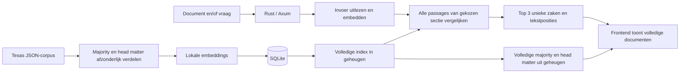
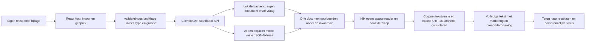
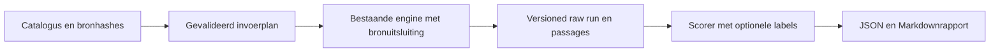

# Architectuurgids

## Huidige stand

De Rust-backend en React-frontend zijn beschikbaar. Deze versie voegt `head_matter` toe naast de bestaande standaard `opinion_chunks`, met afzonderlijke bronsecties en reproduceerbare A/B-uitvoer. De onafhankelijk gecontroleerde dual-index bevat 135 zaken, 578 majoritypassages en 790 head-matterpassages. De tijdelijke featurepreview is na haar controles gestopt en de oorspronkelijke demo is toen hersteld. Het lokale startprofiel gebruikt Mike5176, Rust8000 en evaluaties8798 met dezelfde schema-3-index. Slechts één native modeljob mag tegelijk draaien; herstartcommando’s en verificatiebewijs staan in de [lokale setup](LOCAL_SETUP.md). Hybrid search en een top-vijfcontract zijn niet ingevoerd.

De [evaluatieviewer](../evals/web/index.html) toont uitsluitend de compacte B1/E06-kaarten, ieder met één methodekeuze en startknop. De25 canonieke scenario’s blijven beschikbaar in de bronnen en CLI. De ontwerpbeschrijvingen blijven in de broncatalogus, buiten de zichtbare kaarten. De technische Rustrunner en metricsscorer zijn beschikbaar; kandidaatlabels en gemeten juridische kwaliteit ontbreken nog.

## Resourcecheckpoint vóór nieuwe modelmetingen

De eerste volledige dual-indeximport (1368 passages) is door de bestaande guard op de RSS-grens gestopt: groepspiek 1573,34 MiB na 140,48 seconden, zonder swapgroei en met normale geheugendruk. Die run publiceerde geen database. De gerichte oplossing in [importing.rs](../backend/src/engine/importing.rs) verdeelt de import over sequentiële processen van maximaal 256 passages. De ouder laadt geen model; elke worker gebruikt de oorspronkelijke tokenizer/modelconfiguratie en sluit volledig vóór de volgende start. Configuratie, bronhash, batchposities/-aantallen en complete index worden gecontroleerd vóór één atomische SQLite-publicatie. De hele procesboom houdt dezelfde RSS-/swap-/tijdbewaking; er is geen limietverhoging. De daaropvolgende bewaakte hercontrole slaagde in 273,8 seconden met 1196,9 MiB groepspiek, normale geheugendruk en geen swapgroei. Alle 578 behouden majorityvectoren bleven bytegelijk. De onafhankelijke API-/browsercontrole doorliep beide methoden en alle invoermodi; drie gepaarde webscenario’s en één CLI-run controleerden bronuitsluiting en lineage. Dit bewijst de technische werking, geen juridische kwaliteitsverbetering. De echte runtimebewijzen horen bij codehead `2fa5b1a`; latere integratie wijzigt de Rust-engine niet. De modelkeuze in de productfrontend wordt afzonderlijk modelvrij met opgeslagen responses en de gekozen retrievalmethode gecontroleerd.

[embedding.rs](../backend/src/engine/embedding.rs) voert native inference nu uit met maximaal één tekst per call, met twee ONNX-threads. Iedere native call levert eerst de genormaliseerde vector op en laat zijn ruwe uitvoer los voordat de volgende tekst begint. Alleen een kleine interne batchgrootte meegeven aan één volledige corpuscall was onvoldoende: fastembed bewaart dan de ruwe uitvoer van alle interne batches tot de export. De nieuwe helper controleert ook het aantal teruggegeven rijen per call, behoudt de invoervolgorde en logt aantallen als voortgang zonder documentinhoud. De eerste bewaakte proef met vier teksten van ongeveer 465 tokens is bij de eerste inference gestopt op een gemeten groepspiek van 2637,64 MiB, zonder swapgroei. Daarom is de native grens aangescherpt naar één; de RSS-grens is niet verhoogd. De kleinere grens is vervolgens in de onderstaande bewaakte proeven onderzocht.

De vaste-lengteproef met native grens één slaagde met een piek van 1415,45 MiB, maar de daaropvolgende volledige import stopte alsnog bij 12/578 teksten op de RSS-grens (werkelijke kindpiek 1625,36 MiB), zonder swapgroei. Daarom wordt de getypeerde CPU-provider nu expliciet met `with_arena_allocator(false)` geregistreerd; een registratiefout geeft een fout in plaats van stille fallback. Dit verandert geen modelgewichten, rollen, tokenbudget of scoring. De kleine resourceproef gebruikt nu wisselende korte, middellange en bijna-maximale lengtes in dezelfde sessie. De daaropvolgende bewaakte proef bepaalde of deze allocatie-instelling voldoende ruimte gaf vóór een nieuwe import.

De variabele-lengteproef met CPU-arena uit stopte op 1568,56 MiB. Daarom is als hardwareaanpassing de standaard statisch gequantiseerde BGE-small-variant gekozen: `BGESmallENV15Q`, repository `Qdrant/bge-small-en-v1.5-onnx-Q`, bestand `model_optimized.onnx`. Fastembed-metadata bevestigt statische quantisatie, CLS-pooling en 384 dimensies; modelrollen, 480-tokenbudget, native grens één, twee threads en arena uit blijven gelijk. De configuratie bewaart de quantisatiemodus in het SDK-veld en hasht het daadwerkelijke modelbestand. Een eerdere MiniLM- of FP32-configuratie kan hierdoor niet als dezelfde index worden gebruikt. De bewaakte volledige import van deze variant slaagde in 90,06 seconden met 135 zaken en 578 passages, piek-RSS 1105,86 MiB, normale geheugendruk en geen swapgroei. De geheugenlimieten zijn niet verhoogd. Manifestformaat 2 bindt de verse index aan model, quantisatie, pooling, queryinstructie en modelbestanden; oudere MiniLM- en FP32-databases zijn geen geldige terugval. De bewaarde oorspronkelijke 0/15-meting blijft een indicatieve AI-beoordeling, geen menselijke juridische referentie.

[resource_guard.py](../backend/scripts/resource_guard.py) start precies één eigen procesgroep, meet elke seconde de gezamenlijke RSS van die groep en leest de macOS-geheugendruk en swap. Het script start alleen bij normale druk (`kern.memorystatus_vm_pressure_level = 1`) en stopt de eigen groep bij RSS vanaf 1536 MiB, niet-normale druk, swapgroei vanaf 128 MiB of de tijdslimiet. Meetfouten stoppen de job eveneens; andere gebruikersprocessen worden niet gesignaleerd. Gewone modelchecks en imports blijven begrensd op maximaal 600 seconden. Alleen `--serve-preview` met precies een concreet pad naar `texas-case-finder` gevolgd door `serve` staat een bewaakte preview tot 7200 seconden toe; shell-/Cargo-wrappers en PATH-aliassen zijn uitgesloten. Geheugen-, druk-, swap- en stopgedrag veranderen daarbij niet. Het JSON-verslag bevat proces-ID's, monsters, piek-RSS en stopreden; logs en verslagen horen buiten Git. Modelchecks moeten één voor één draaien, met `--test-threads=1`.

De twee native-boundsregressies zijn rood en daarna groen uitgevoerd. De standaard Rust-run slaagde met vijftien deterministische tests; zes echte modelchecks blijven genegeerd. De Python-beleidstests beschermen de geheugen- en timeoutgrenzen; drie extra regressies testen de expliciete previewtoestemming en afwijzing van wrappers/aliassen. Zij starten geen model of systeemprobe en draaien ook in de backend-CI. De kleine modelsmoke en volledige import zijn onder de guard uitgevoerd; de gezamenlijke live demo is onafhankelijk gecontroleerd en de afzonderlijke AI-doelmatchindicatie is vastgelegd. Deze technische controles bewijzen geen juridische relevantie. De oude kwaliteitsscore 0/15 blijft een bewaarde, ongewijzigde baseline.

De repo bevat het API-contract, synthetische fixtures, de geteste Axum-router en PDF/TXT-extractie, en de data-/zoekengine met corpusimport en SQLite-opslag. De server/CLI-koppeling bestaat. Deterministische tests en een echte TCP-doorloop met ontbrekende database zijn gecontroleerd; de nieuwe BGE-index is vooraf berekend en de gezamenlijke UI/API-eindcontrole is afgerond. Frontendimplementatie valt buiten deze backendwijziging.

De React/TypeScript-frontend in [`frontend/`](../frontend/) werkt lokaal met Vite en kiest standaard de echte lokale API. Synthetische [fixtures](../fixtures/api/search-response.json) blijven uitsluitend beschikbaar in expliciete mockmodus. De frontend heeft een chatinvoer, PDF/TXT-bijlage, drie klikbare documentvoorbeelden onder de invoerbox en een aparte leesweergave met exacte tekstmarkeringen.

De [README](../README.md) is het startpunt; [AGENTS.md](../AGENTS.md) bepaalt hoe agents samenwerken. Het contract is een productafspraak. Deze gids legt de samenhang, afwegingen en grenzen uit.

## Volledige demo met één commando

De uitvoerbare rootentry [`start`](../start) roept [`start_demo.py`](../backend/scripts/start_demo.py) aan. De launcher leest portable standaardpaden, optionele genegeerde `start.local.json` en expliciete environmentoverrides. Hij controleert de bestaande B1-v2-snapshot, E06-bron en exacte model-/tokenizerbestandsvingerafdruk voordat een model wordt geladen. Ontbrekende/corrupte index of cache geeft een setupfout; starten importeert geen corpus en downloadt geen embeddings.

Benodigde Rustbins (`texas-case-finder` en `document_text`) en frontendonderdelen worden indien nodig gebouwd. Dependencyprocessen krijgen geen Orq-credential. De documentextractor wordt alleen aan de Orq-sidecar doorgegeven. Een pergebruiker native-slotlock plus controle op bestaande modeltaken voorkomt een tweede native job; poortconflicten stoppen veilig zonder andere processen te signaleren.

De bestaande gedeelde loader accepteert een private keyfile/environmentwaarde; zonder beide vraagt alleen een interactieve terminal verborgen om de sleutel. Een tijdelijke0600-file voor een ENV/ingevoerde sleutel wordt na de eigen services gewist. Een door de gebruiker aangeleverd bestand wordt nooit gewijzigd of verwijderd. Frontend, browserhelpers en builds krijgen de sleutel niet. Interne regeleinden in een sleutel worden zonder waarde-echo afgewezen.

Daarna starten één bewaakte Rustbackend, de echte Orq-sidecar, evalserver en Vite. Mike wijst expliciet naar de Orq-sidecar; beide modelservices delen dezelfde keyfile en `ORQ_BASE_URL`. De default verwijst naar Orq; een localhostbase is uitsluitend een expliciet geconfigureerde providercontracttest, geen ingebouwde replay. E06 staat bij geconfigureerde credential standaard op AI-beoordeling; paginaload doet nog geen generatie. De gebruiker kan die checkbox uitzetten voor lokale vergelijking.

Healthchecks wachten op de juiste index en beschikbare services voordat beide browserpagina’s openen. SIGINT/Ctrl+C en SIGTERM ruimen alleen de geregistreerde eigen procesgroepen op; de resourceguard ruimt zijn afzonderlijke native-kindgroep op. Ook gedeeltelijk mislukte startup valt onder die cleanup. De bestaande1536MiB-RSS-/128MiB-swapgrenzen en maximaal twee uur blijven gelden. macOS gebruikt ongewijzigde sysctldruk; Linux leest `/proc/meminfo`, weigert ongeldige metingen en stopt conservatief onder10% beschikbaar geheugen. Dit is geen universele drukmeting of hostinggarantie. De [uitgebreide setup](LOCAL_SETUP.md) bevat het configuratie- en handmatige contract.

## Geverifieerde bouwbasis

- [backend/Cargo.toml](../backend/Cargo.toml) en de lockfile vormen een zelfstandige Rust 2024-crate; er is geen rootworkspace. De directe COA-patronen zijn Axum 0.8, fastembed exact 7.1.2 met dezelfde native-TLS/ONNX-downloadfeatures, serde, Tokio en SHA-256.
- [backend/src/lib.rs](../backend/src/lib.rs) exporteert de HTTP-router, extractie, configuratie en de echte engine. [main.rs](../backend/src/main.rs) biedt `import`, `search` en `serve`.
- SQLite gebruikt de gebundelde SQLite-build via rusqlite. De HTTP-router gebruikt CORS en YAML-naar-JSON voor het canonieke OpenAPI-contract. PDF-extractie gebruikt pdf-extract; scans vereisen OCR en worden geweigerd.
- [.github/workflows/backend-checks.yml](../.github/workflows/backend-checks.yml) volgt de COA-checkvolgorde: expliciete Rust-toolchain, fmt, clippy, deterministische tests en build. De standaardchecks laden geen embeddingmodel.
- De gecontroleerde commando's staan in de [lokale setup](LOCAL_SETUP.md). Routertests gebruiken het COA-patroon met `tower::ServiceExt::oneshot` en echte responsebytes. Alleen de enginegrens wordt vervangen door de contractfixtures; deze tests bewijzen nog geen echte retrieval of TCP-doorloop.

## HTTP-invoer en tekstextractie

[api::router](../backend/src/api.rs) biedt de vijf contractroutes en configureerbare CORS. `POST /api/search` leest de velden `query`, `document` en optioneel `retrieval_method`, weigert dubbele/onbekende velden en behandelt een lege vraag als afwezig. Een ongeldig meegestuurd document wordt ook naast een geldige vraag geweigerd. Er is geen overgenomen COA-limiet van 1000 vraagtekens of 8192 requestbytes.

[extract_document](../backend/src/extraction.rs) behoudt UTF-8-TXT en extraheert tekst uit PDF. De bestandsgrootte wordt tijdens het lezen per document geteld: precies 10 MiB blijft geldig, los van multipartheaders. De vraag wordt tijdens het lezen op 1 MiB UTF-8 begrensd en de hele multipartrequest op 12 MiB. PDF-uitvoer wordt tijdens het schrijven op 20 MiB begrensd; een panic in de externe parser wordt een 422-fout. Dit is geen procesisolatie of harde CPU-/decompressiegrens voor de PDF-library.

PDF-parsing en enginewerk draaien via `spawn_blocking`; een mutex bewaakt de engine. Zonder geladen engine geven health, zoeken en zaakdetails 503; er is geen fictieve terugval. [ApiError](../backend/src/api_error.rs) levert het afgesproken JSON-foutformaat zonder interne enginediagnostiek.

[service.rs](../backend/src/service.rs) leest de instelbare database-/cachepaden, bindadres en CORS-origins. [main.rs](../backend/src/main.rs) laadt één engine bij `serve` en bindt standaard op `127.0.0.1:8000`. Een ontbrekende of ongeldige index start de router zonder engine, met 503 voor health, zoeken en zaakdetails; `/openapi.json` blijft beschikbaar. Na import is een serverherstart nodig. Het CLI-commando `search` gebruikt dezelfde engine en ranking als HTTP, zonder tweede implementatie.

### Frontendcontract

[OpenAPI](openapi.yaml) blijft het canonieke veld- en foutcontract. De browser stuurt `document` en/of `query` met `FormData` en laat de browser de multipart-boundary zetten; stel zelf geen `Content-Type` in. Een lege vraag is afwezig en minstens één invoer moet bruikbaar zijn. De limieten hierboven worden zonder stille truncatie gehandhaafd.

Een succesvolle zoekresponse bevat `retrieval_method`, `mode` (`query`, `document` of `combined`), `corpus_version`, `ranking_version` en drie unieke `results`, op aflopende score. Elk resultaat bevat `case_id`, `title`, `court`, `decision_date`, `citation`, `case_url`, `text_version`, `score` en `passage`. De score ligt tussen -1 en 1 en is geen percentage of juridische zekerheid; een gevalideerde relevantiedrempel ontbreekt. Een passage bevat `passage_id`, de oorspronkelijke `text`, `start_utf16` en `end_utf16`, aangevuld met `source_section` en de eigen `text_version`.

De client volgt `case_url` naar `GET /api/cases/{case_id}`. Het detail bevat de volledige canonieke majority in `text`, met dezelfde zaakmetadata, corpus- en tekstversie; afwijkende opinions horen daar niet bij. `head_matter` en `head_matter_text_version` zijn afzonderlijk beschikbaar. Een head-matterpassage wordt uitsluitend in die redactionele sectie gemarkeerd, met de volledige majority eronder. Voor majority moet `text.slice(start_utf16, end_utf16)` exact gelijk zijn aan `passage.text`: JavaScript/UTF-16-eenheden, nulgebaseerd, begin inclusief en einde exclusief. Normaliseer of verkort de tekst niet vóór markering. Render veilige tekstnodes met bijvoorbeeld `<mark>`, geen ruwe HTML.

Controleer zaak-ID, `corpus_version` en majority-`text_version` tussen resultaat en detail, plus de eigen passageversie tegen de gekozen sectie. Bij afwijking moet de gebruiker opnieuw zoeken; pas oude posities niet toe op nieuwe tekst. Alleen oude synthetische opinion-fixtures zonder sectie/passagetekstversie vallen terug op majority. Head matter vereist een expliciete sectie en eigen versie. Eén beste passage per zaak ondersteunt een markering; de API levert geen oorspronkelijke PDF of PDF-coördinaten.

De gedeelde [search-response.json](../fixtures/api/search-response.json) is één volledige queryresponse; [cases.json](../fixtures/api/cases.json) is een array van drie details. Een mock voor `GET /api/cases/{id}` kiest daaruit één object op `case_id`, niet de volledige array. Namen, teksten, scores en datums zijn verzonnen. De mock past alleen de invoermodus aan en beoordeelt de aangeleverde inhoud niet.

Alle fouten gebruiken `{"error":{"code":"...","message":"..."}}`; toon de leesbare `message`.

| HTTP | Betekenis |
|---|---|
| 400 | Geen bruikbare invoer, ongeldige multipart/methode of vraag groter dan 1 MiB UTF-8. |
| 413 | Document groter dan 10 MiB of volledige multipartrequest groter dan 12 MiB. |
| 415 | Ander bestandstype dan PDF/TXT. |
| 422 | Meegegeven bestand onleesbaar, leeg, versleuteld, scan zonder uitleesbare tekst of PDF-tekst groter dan 20 MiB. |
| 404 | Gevraagde zaak bestaat niet. |
| 503 | Volledige zoekindex niet beschikbaar. |
| 500 | Onverwachte backendfout. |

`GET /api/health` geeft uitsluitend bij het volledige beschikbare corpus 200 met `status: ready`; anders 503. `GET /openapi.json` biedt het contract ook zonder geladen index. Rust gebruikt configureerbare CORS-origins via `ADAMI_CORS_ORIGINS`, standaard beide localhost/127.0.0.1-origins op 5173. De [lokale setup](LOCAL_SETUP.md) beschrijft de gezamenlijke en afzonderlijke frontendprofielen. API-/netwerkfouten worden nooit door fictieve resultaten vervangen en een servercredential hoort nooit in de frontend.

## Geïmplementeerde data-/zoekengine

[engine/mod.rs](../backend/src/engine/mod.rs) verbindt import, opslag en zoeken. `import_corpus` leest de JSON-map; [corpus.rs](../backend/src/engine/corpus.rs) selecteert precies één majority opinion, leest head matter als afzonderlijke redactionele tekst, gebruikt `decision_date` en bewaart de exacte oorspronkelijke UTF-8-JSONbytes inclusief aanvullende opinions. Zo blijven ook brongetallen en witruimte behouden in plaats van een opnieuw geserialiseerde benadering. Canonieke tekst normaliseert CRLF/CR naar LF en verwijdert uitsluitend omringende witruimte. `text_version` is SHA-256 van de UTF-8-bytes van die exacte meerderheidstekst. `head_matter_text_version` identificeert op dezelfde manier de afzonderlijk gecanoniseerde head matter.

[chunk.rs](../backend/src/engine/chunk.rs) maakt overlappende passages met oorspronkelijke byte- en UTF-16-grenzen. Een kandidaat beslaat maximaal 1600 Unicode-tekens en wordt kleiner zolang de echte tokenizer meer dan 480 tokens telt, inclusief speciale tokens. De normale overlap is 160 tekens; bij korte passages blijft voorwaartse voortgang gegarandeerd. Er wordt geen tekst stil afgekapt. Zowel lange vragen als documenten worden volledig verdeeld; hun passagevectoren krijgen een opnieuw genormaliseerd gemiddelde.

[embedding.rs](../backend/src/engine/embedding.rs) hergebruikt het lokale fastembed-/cachepatroon uit COA, met nu `BGESmallENV15Q` voor Engels. De gekozen BGE-small-en-v1.5-variant gebruikt CLS-pooling en 384 dimensies. Alleen vraagpassages krijgen de instructie `Represent this sentence for searching relevant passages: `; corpus- en documentpassages niet. Het tokenbudget telt die instructie mee en truncatie staat uit. Een procesbrede gedeelde ONNX-omgeving maakt meerdere modelinitialisaties mogelijk, ook na import en het laten vallen van de vorige sessie; de directe `ort`-dependency gebruikt dezelfde reeds transitief gelockte versie. Modeltruncatie staat uit; iedere embeddinginvoer wordt vooraf tegen het tokenbudget gecontroleerd. De configuratie registreert SDK, model, dimensies, limiet en SHA-256 van de daadwerkelijk gebruikte model-/tokenizerbestanden en cacherevisie. De modelcache is een instelbaar pad buiten Git. De zoekkwaliteit heeft uitsluitend een indicatieve AI-evaluatie, zonder menselijke juridische ijking.

[storage.rs](../backend/src/engine/storage.rs) bewaart bronrecords, passages, vectorbytes en manifest in SQLite. De importcoördinator start uitsluitend sequentiële begrensde subprocessen; alleen de actieve worker houdt een model vast. Het manifest gebruikt formaat 3 en bindt beide bronsecties in dezelfde index. Iedere passage bevat haar bronsectie en eigen tekstversie; passages uit verschillende secties hebben verschillende IDs. Een herimport vervangt de index in één transactie. `Engine::load` leest uitsluitend een bestaande database en accepteert pas een snapshot na controle van alle 135 afgesproken case-identiteiten, volledige passagebedekking per zaak én sectie, tekstversies, UTF-16-grenzen, vectoraantallen/-dimensies, eindige niet-nulvectoren en integriteit van het volledige manifest. De vaste identiteitenhash is afgeleid van de lexicografisch gesorteerde case-ID's uit het aangeleverde corpus. De huidige modelconfiguratie moet exact overeenkomen; gewijzigde bestanden of configuratie vereisen herimport. De engine doet bij laden geen impliciete herindexering.

[ranking.rs](../backend/src/engine/ranking.rs) bevat de overgenomen COA-cosinusfunctie en haar numerieke regressietest, met bronverwijzing in het bestand. De casegroepering volgt `cosine-max-v1`: alle passages van de gekozen bronsectie vergelijken, maximum per zaak, vaste passage-/case-ID-ties en exact drie unieke zaken. Numeriek gelijke scores, inclusief positief en negatief nul, volgen dezelfde case-ID-tie-break. [types.rs](../backend/src/engine/types.rs) beschrijft de contractresponses. De engine levert de oorspronkelijke beste passage met bronsectie en eigen tekstversie. Zaakdetails bevatten de volledige canonieke majority-tekst plus afzonderlijke head matter; hij genereert geen antwoord.

De deterministische tests controleren onder meer Unicode/overlap, drie invoermodi, lange vragen, casegroepering, beide tie-breaks, bronidentiteit, duplicaten, herimport, corrupte opslag en een partiële index met nog drie resterende zaken. Ze gebruiken bekende embeddingvectoren aan de modelgrens. De echte modeltest controleert daarnaast onverkorte tokenaantallen en vectorvorm. De afzonderlijke echte-corpuscheck importeert alle zaken en herlaadt de index, maar vervangt geen inhoudelijke beoordeling van zoekkwaliteit.

De onafhankelijk geschreven module `independent_reference_tests` in [ranking.rs](../backend/src/engine/ranking.rs) vergelijkt productie-uitkomsten met een volledige f64-referentieberekening zonder de productiecosinus of casegroepering aan te roepen. De voorbeelden controleren alle drie invoermodi, een beste zaak aan het einde van de invoer, passage- en caseties, omgekeerde invoervolgorde en scores van weggelaten zaken. Extra grensgevallen controleren ongeldige vectoren, minder dan drie zaken en de normalisatie van een gemiddelde documentvector. Deze modelvrije tests zijn in een afzonderlijke reviewtarget uitgevoerd; een gedeelde Cargo-target tussen worktrees bleek onbetrouwbaar voor testherkomst.

## Hoofdroute

Een gebruiker geeft een document en/of vraag. De app toont drie verschillende uitspraken, met per zaak de volledige tekst van het meerderheidsoordeel (majority opinion) en de best scorende passage in de juiste bronsectie gemarkeerd.

De mapverdeling is `backend/` voor de Rust-service en gedeelde Python-runtime, `frontend/` voor React en `evals/` voor evaluatiecode, pagina, brondata en tests. Gedeelde synthetische API-fixtures staan in `fixtures/api/`. `docs/` bevat de lokale setup, deze architectuurgids en het API-contract; contractwijzigingen worden afgestemd voordat een agent erop gaat bouwen.

## Selecteerbare bronindex en één gedeelde evalengine

`RetrievalMethod` in [types.rs](../backend/src/engine/types.rs) kent `opinion_chunks` en `head_matter`; de bestaande majoritymethode blijft de standaard. Beide methoden gebruiken hetzelfde BGE-model, dezelfde passageverdeling, normalisatie, 70/30-gewichten en deterministische top drie. Head matter wordt ook in korte passages verdeeld wanneer het tokenbudget dat vereist. De bronkeuze verandert uitsluitend welke corpuspassages worden vergeleken; een documentinvoer blijft het aangeboden document.

[api.rs](../backend/src/api.rs) accepteert de optionele multipartmethode en rapporteert haar in de zoekresponse. De additionele `POST /api/evals/search` hergebruikt de bestaande mutex/engine, past expliciete bronuitsluitingen vóór top drie toe en retourneert de response plus uitsluitingen, kandidaatenaantal en volledig indexmanifest. De lokale web-evals starten hiervoor geen tweede Rustmodelproces. De extra multipartwaarde `excluded_case_ids` is een JSON-array als tekst. Onbekende/dubbele IDs of minder dan drie overblijvende zaken geven 400. De response is `{response, excluded_case_ids, eligible_case_count, index_manifest}`; `response` is de gewone zoekresponse. A en B moeten dezelfde invoer, uitsluitingen en volledige manifesten gebruiken. De UI toont uitsluitend B1/E06; de overige25 scenario’s blijven in de broncatalogus en CLI beschikbaar. Een gezamenlijke webbatch is niet gebouwd. Er wordt bij deze route geen Orq-judge aangeroepen.

De CLI accepteert `search --retrieval-method head_matter QUESTION` en `eval SCENARIOS CORPUS OUTPUT --retrieval-method head_matter`. De Rustrunner bewaart de methode in artifactformaat 2 (`rust-eval-v2`) en controleert dat alle responses en passages dezelfde geselecteerde sectie gebruiken. Labelbewijs blijft gekoppeld aan de majority-brontekst; head-matterrankingpassages worden afzonderlijk bewaard en niet als goldbewijs gepresenteerd.

Een oude majority-only database is niet geschikt voor het nieuwe dubbele schema. De engine weigert die vóór modelladen; herimport gebeurt expliciet naar een nieuw databasepad. De oude demo-index blijft behouden. Een lokale A/B-vergelijking bewaart echte rankings, timings, invoer en model-/corpusversies. Zonder onafhankelijke kandidaatlabels zijn overlap en rangverschillen diagnostiek, geen Recall/nDCG of juridische kwaliteitswinst.

## Bestaande frontend: invoer, documentvoorbeelden en leesweergave

[`frontend/src/main.tsx`](../frontend/src/main.tsx) kiest bij het starten een client en rendert de React-app. [`createSearchRuntime` in `runtime.ts`](../frontend/src/runtime.ts) kiest standaard de HTTP-client in [`client.ts`](../frontend/src/client.ts), met configureerbare `VITE_API_BASE_URL` (standaard `http://127.0.0.1:8000`). Uitsluitend `VITE_API_MODE=mock` kiest de lokale fixtureclient; onbekende of ontbrekende moduswaarden selecteren nooit fixtures. API-, index- en netwerkfouten worden doorgegeven aan de bestaande foutweergave, zonder terugval naar verzonnen resultaten. Er zijn geen externe modelaanroepen, accounts of extra UI-libraries.

[`App` in `app.tsx`](../frontend/src/app.tsx) houdt de invoer, bijlage en laatste succesvolle zoekresponse alleen in browsergeheugen. De naam Mike, huidige vraag en invoerbox blijven het vertrekpunt. Een zoekopdracht blokkeert dubbele verzending tijdens laden en toont daaronder precies drie klikbare documentvoorbeelden. Mike gebruikt vaste opinion-chunks (B); methodekeuze A/B staat uitsluitend op de evaluatiepagina. Het resultaat bewaart zijn eigen bronsectie. Op desktop staan ze naast elkaar; op smalle schermen onder elkaar. Een volgende succesvolle zoekopdracht vervangt de vorige resultaten. Er is geen stapelende chatgeschiedenis boven de invoerbox. Mislukte zoekopdrachten houden de invoer en eventuele vorige resultaten beschikbaar. Enter verstuurt, Shift+Enter maakt een nieuwe regel.

Klikken op een document opent `DocumentReader` als aparte leesweergave op dezelfde pagina. De invoer en resultaten zijn dan verborgen, niet verwijderd. De reader haalt de zaak pas op bij openen, toont laad-/foutstatus en negeert een nog lopende detailresponse na sluiten. De volledige aanwezige meerderheidstekst blijft onverkort beschikbaar in de gewone paginascroll. ‘Terug naar resultaten’ herstelt focus op het gekozen document en de eerdere scrollpositie; readeropenen verplaatst focus naar de documenttitel. Upload-, document- en terugknoppen hebben toegankelijke namen.

De voorbeelden gebruiken een sober pagina-icoon, zaakmetadata en een excerpt uit de exacte gevonden passage. Ze stellen geen originele PDF, officiële paginering of gerechtszegel voor. In de reader staat één compacte toelichting boven de volledige tekst; de gevonden passage is uitsluitend in die volledige tekst gemarkeerd, zonder herhaalde quote, spronglink of score in het uitlegblok. De gewone API levert brononderbouwing; de optionele Orq-adapter voegt gevalideerde modeltoelichting toe. De optionele uploadbewuste route kan nu ook de volledige uitgelezen uploadtekst vergelijken; oude query-only-responses blijven ondersteund. De mock meldt compact bij de resultaten dat het voorbeelden zijn en geen analyse van de invoer; ook de reader benoemt zijn onderbouwing als voorbeeld. De frontend verzint zelf geen juridische verklaringen; extra toelichting komt uitsluitend uit de optionele, gevalideerde Orq-response.

[`validateInput` in `search.ts`](../frontend/src/search.ts) trimt de vraag en accepteert PDF/TXT-extensies tot en met 10 MiB. Lege bestanden en ongeldige meegegeven bestanden blokkeren ook een geldige vraag. De mock leest de bestandsinhoud niet: een verkeerd benoemde, onleesbare PDF of scan wordt hier niet inhoudelijk herkend. Dat blijft backendwerk. De mock past `mode` wel aan naar `query`, `document` of `combined`, maar geeft voor elke invoer dezelfde drie **synthetische** resultaten. Dit is geen implementatie of validatie van de juridische zoekmethode.

[`getPassageParts` in `search.ts`](../frontend/src/search.ts) vergelijkt corpusversie, tekstversie en zaak-ID en controleert dat de exacte UTF-16-uitsnede overeenkomt met `passage.text`. De bron wordt niet opnieuw genormaliseerd en React rendert tekst veilig met een `<mark>`. Bij oude versies of onjuiste posities toont de UI een fout met het verzoek opnieuw te zoeken; de gebruiker start die nieuwe opdracht zelf.

De HTTP-client gebruikt `FormData` zonder een eigen multipart-Content-Type, volgt de aangeboden `case_url` en toont backendfoutberichten. Naast de tests met onderschepte HTTP-grens is de echte browser/backendintegratie uitgevoerd: query/TXT/PDF/combinatie, drie volledige brondocumenten met markeringen en herstel na een 422-fout. De API-schemas blijven vastgelegd in [OpenAPI](openapi.yaml).

Vanuit `frontend/`: `npm ci`, `npm run dev`, `npm test` en `npm run build`. De devserver bindt aan `127.0.0.1:5173`; Vite wisselt niet stilzwijgend naar een andere poort. Tests in [`search.test.ts`](../frontend/src/search.test.ts) controleren invoermodi, bestandgrenzen, mock/details, multipart en versie-/Unicode-markeringen; [`app.test.ts`](../frontend/src/app.test.ts) controleert de React-route van eigen tekst naar drie documenten onder de invoerbox, volledige veilige bronweergave en brononderbouwing, terugkeerfocus, vervanging van de vorige resultaten en herstel na invoer-/zoekfouten. De productiebuild voert ook TypeScript-controle uit. De lokale frontend en gezamenlijke API/UI-doorloop zijn hiermee gecontroleerd. De gewone frontend op 5173 kiest standaard API; een extra expliciete API-preview kan op 5174 draaien. `npm run dev:mock` is een aparte opt-in voor fictieve resultaten en gebruikt eveneens 5173. [`runtime.test.ts`](../frontend/src/runtime.test.ts) beschermt standaard-APIkeuze, expliciete mockkeuze en foutdoorgifte zonder fixtureterugval. Backendimport en backendtests staan in de andere hoofdstukken beschreven.

## Optionele Orq-toelichting

De sidecar levert optioneel `explanation_status`: `available` vereist drie gevalideerde toelichtingen met `explanation: {text, citations: [{passage_id, quote}], limitations}`. Het model kiest alleen toegestane bron-ID’s; de server vult de exacte quotes in. Ongeldige tool-/schema-/citaatuitvoer behoudt de echte top drie met status `unavailable`. Expliciete provider-HTTP- of modelidentiteitsfouten geven 502 `model_unavailable`, zonder modelwissel. Fouten van de zoekbackend volgen het gewone foutcontract; Rust8000 hoeft deze optionele uitlegvelden niet te leveren.

Bij uploads bevat `input_context` de SHA-256-`text_version` van de exacte UTF-8-extractie en `utf16_length`. `input_citations` bevat servergeverifieerde `{quote, start_utf16, end_utf16}` met begin inclusief/einde exclusief. Onbekende of verwisselde input-ID’s maken de uitleg `unavailable`, zonder de drie zoekresultaten te veranderen. Vraag-only laat deze uploadvelden weg. Alleen aangehaalde uploadstukken worden teruggestuurd, geen apart volledig uploadtekstveld; de reader toont deze ingeklapt naast de volledige corpusbron.

[`backend/scripts/orq_proxy.py`](../backend/scripts/orq_proxy.py) is een aparte Python-stdlib-server op 18000, geen vervanging van de Rust-engine. Hij hergebruikt de bestaande HTTP-zoekbackend op 8000 en laadt geen index of embeddingmodel. De frontendpreview op 5175 wijst expliciet naar deze adapter; de gewone frontend/API blijven afzonderlijk bestaan.

De uploadbewuste adapter op 18000 geeft de vraag en volledige canonical uploadtekst aan het gekozen Orq-model. De officiële Orq-frontend gebruikt 5175; de afzonderlijke QA-preview kan 18001/5176 gebruiken. Het model moet eenmaal `search_cases` aanroepen met lege argumenten. De applicatie koppelt dat verzoek aan de oorspronkelijke multipartbytes en stuurt die ongewijzigd naar Rust. Een tweede modelrequest behoudt de volledige uploadcontext en voegt de werkelijk gevonden drie zaken/passages toe. Het vraagt drie korte verklaringen met bestaande case-/passage-ID’s en, bij uploads, ten minste één toegestane inputpassage-ID per zaak, ook om verschillen of zwakke overeenkomsten te onderbouwen. De server valideert exacte identiteit, aantal en schemagrens en voegt zelf de oorspronkelijke passage als citaat toe. De oorspronkelijke resultaten, volgorde, scores en bronversies worden niet door het model aangepast. Er is geen reranking of vrije vervolgzoekloop.

De HTTP-uitbreiding is optioneel en achterwaarts compatibel: `explanation_status` en per resultaat `explanation` staan in [OpenAPI](openapi.yaml). De sidecar serveert zijn uitgebreide runtimecontract op `/openapi.json`; health en volledige zaakteksten komen van de bestaande backend. Ongeldige tool-/schemauitvoer geeft echte zoekresultaten met `unavailable`; provider-HTTP- en modelidentiteitsfouten geven expliciet 502 `model_unavailable` zonder modelvervanging, nooit fictieve zoekresultaten. Bij een mislukte modelstap logt de adapter alleen een vaste fase en foutcode, een exceptiontype of HTTP-status; geen providerantwoord, foutbericht, vraag, uploadtekst of sleutel. De reader toont gevalideerde modeltekst en noodzakelijke beperkingen samen in één compacte paragraaf boven de volledige meerderheidstekst. Dezelfde bronpassage wordt daar niet nogmaals geciteerd; de markering in de volledige tekst blijft behouden. Bronverwijzingen blijven in de gevalideerde API-response aanwezig. Corpus-/tekstversie en UTF-16-markering blijven de bestaande controles gebruiken.

De sleutel wordt uitsluitend serverzijdig uit `ORQ_API_KEY` of een privé `ORQ_API_KEY_FILE` buiten Git geladen. Uploadbytes gaan naar de eigen zoekbackend; de expliciet geautoriseerde uitgelezen uploadtekst gaat nu volledig naar Orq, evenals vraag en corpuspassages. De oude niet-gelezen-uploadbeperking wordt in deze route niet meer toegevoegd. Orq krijgt `store: false`; gateway-/providerretentie is hiermee niet geaudit. De adapter staat één zoekopdracht tegelijk toe, maximaal twee modelrequests per opdracht, 30 seconden provider-timeout, 128 KiB providerinvoer, 1 MiB providerantwoord en een eindig procesbudget (standaard twintig requests). De echte bestaande modelserver en zijn resourceguard worden niet door de sidecar beheerd.

[`backend/src/bin/document_text.rs`](../backend/src/bin/document_text.rs) is een minimale stdin/stdoutbrug naar de bestaande `extraction::extract_document`. Hij laadt geen zoekengine of model en schrijft geen uploadbestanden. Python geeft geen `ORQ_*`-secretomgeving aan dit proces door en begrenst het op 15 seconden. Dezelfde TXT/PDF-grenzen en fouten blijven gelden, inclusief 10 MiB bestandsinhoud, 20 MiB PDF-extractie, UTF-8 en onleesbare scans. De exacte extractietekst blijft behouden, ook CRLF en omringende whitespace; hashing, aaneensluitende inputpassages en UTF-16-posities worden allemaal op diezelfde tekst berekend.

De modelvergelijking heeft een eigen standaardgrens van 48 KiB canonical UTF-8-uploadtekst, configureerbaar met `--max-upload-text-bytes`, plus 100 KiB eerste geserialiseerde context en 128 KiB per providerrequest. Te grote invoer wordt expliciet afgewezen; er is geen stille selectie of afkapping. Alle uploadpassages gaan in beide providerrequests mee. Het model kiest uitsluitend input-ID’s uit een strikt schema; de server maakt exacte quotes/UTF-16-posities. De response bevat `input_context` (teksthash en lengte) en optionele `input_citations`, geen apart veld met het volledige document. De frontend toont aangehaalde uploadstukken onder een compacte ingeklapte bron; het volledige corpusdocument met markering blijft ongewijzigd. Voor vraag-only zijn inputcitaten afwezig, document-only gebruikt nu de inhoud als vergelijkingsbasis. Dit voegt geen reranking of indexmodel toe.

De exacte modelroute `openai/gpt-4.1-mini-2025-04-14` is via de live catalogus en een kleine tool-/structured-outputpreflight gecontroleerd; `ORQ_MODEL` of `--model` kan haar wijzigen. Andere modelroutes zijn niet automatisch gevalideerd. [`test_orq_proxy.py`](../backend/scripts/test_orq_proxy.py) controleert toolvolgorde, ongewijzigde invoer/resultaten, bron-ID’s/citaten, foutdoorgifte, uploadcontext, bestandstatussen en runtimecontract zonder providerrequests. Startinstructies staan in de [lokale setup](LOCAL_SETUP.md). Dit is geen juridische kwaliteitsevaluatie.

## Evaluaties: regels, code en webpagina

[evals/README.md](../evals/README.md) is de canonieke specificatie van de beoordelingsafspraken. [evals/data/scenarios.json](../evals/data/scenarios.json) bevat 25 concrete ontwerpbeschrijvingen met invoermodus, bronzaak, exact invoerfragment, Engelse zoekvraag waar van toepassing, verwacht juridisch gedrag en onderbouwing. [evals/web/index.html](../evals/web/index.html) is de gegenereerde, klikbare leesweergave uit beide bronnen. De webpagina is de uitvoerbare evaluatie-interface en staat los van de React-productinterface en de synthetische API-fixtures. Python-evaluatiecode, generator en tests staan ernaast in `evals/`; alleen de Rust-runner en metricsscorer blijven in de Rust-crate.

Het startoverzicht toont uitsluitend twee ingeklapte uitvoerbare kaarten voor B1 en E06. De 25 ontwerpbeschrijvingen en onderhoudsblokken zijn uit de zichtbare pagina verwijderd, terwijl de canonieke bronnen behouden blijven. Er is geen extra scenario-overzicht of B1-referentie-/variantbediening. Alleen de exacte Engelse vraag en/of volledige majority opinion gaan als invoer naar zoeken; de Nederlandse leesvertaling, herkomst en voorbeeldcitaten voegen geen verborgen zoekcontext toe.

[evals/build.py](../evals/build.py) maakt de HTML uit de canonieke opdracht en scenariocatalogus. De generator controleert onder meer scenario-ID’s, verplichte inhoud en invoermodi; hij beoordeelt geen juridische kandidaatmatches. Voer vanuit de reporoot `python3 -m evals.build` uit na inhoudswijzigingen; `python3 -m evals.build --check` controleert of de opgeslagen weergave nog overeenkomt. Generatorchecks draaien met `python3 -m unittest discover -s evals -t . -p 'test_*.py'`. Onderhoud bron en afgeleide HTML in dezelfde changeset. De [AGENTS-afspraken](../AGENTS.md#evaluatiedocumentatie-onderhouden) bepalen hoe toekomstige wijzigingen aan invoermodi, beoordelingsregels, status, labels en runs worden verwerkt.

[De documentatieworkflow](../.github/workflows/eval-docs-checks.yml) voert synchronisatie- en generatorchecks uit op pull requests en pushes naar `main` die de bron, viewerbestanden of workflow veranderen. De check genereert niet eerst opnieuw: verouderde opgeslagen HTML faalt dus zichtbaar. Er worden geen corpusdata, modellen of benchmarkruns geladen.

De broncatalogus bevat ontwerpbeschrijvingen, geen beoordeelde retrievalbenchmark of gemeten scores. Kandidaatlabels ontbreken nog. Deze bronnen zijn ontwikkelmateriaal en kunnen niet als verborgen testset worden gepresenteerd. Een statische HTML-pagina start geen lokaal backendproces. De generatiecheck controleert alleen documentatiesynchronisatie. Zonder labels toont de technische runner uitsluitend uitvoer, ontbrekende beoordelingen en tijd; hij claimt geen juridische kwaliteit.

### Technische Rustrunner en metricsscorer

[`evaluation.rs`](../backend/src/engine/evaluation.rs) is een interne enginemodule, zodat corpusnormalisatie, opgeslagen metadata en het indexmanifest rechtstreeks worden hergebruikt. `EvaluationPlan::load` valideert de versie-1-catalogus, unieke scenario-ID’s, bron-ID/datum, het volledige lokale corpus en exacte majorityhashes. `source_case.name` is uitsluitend een presentatienaam en mag afwijken van de volledige corpustitel; identiteit wordt aan de zaak-ID gebonden. De volledige canonieke metadata blijft via het bronrecord aan de index gekoppeld. Document-/combined-invoer gebruikt de volledige majority; query-only gebruikt uitsluitend `query.en`. Nederlandse leesvertalingen, voorbeeldcitaten en het bronanker worden nooit extra zoekinvoer. Bij een verschil tussen exact gedecodeerde majority en canonieke LF-/trimtekst weigert deze catalogusversie de documentinvoer.

`EvaluationPlan::execute_with_method` controleert alle bronrecords tegen de geladen snapshot vóór het meten. [`Engine::search_excluding_with_method`](../backend/src/engine/mod.rs) valideert uitsluitings-ID’s en gebruikt dezelfde embeddings en scorer als `Engine::search`. [`rank_cases_excluding`](../backend/src/engine/ranking.rs) filtert de bronzaak vóór maximumgroepering en selectie van drie zaken. Daardoor vult de vierde kandidaat een uitgesloten zelfmatch aan; de normale HTTP-zoekroute blijft ongewijzigd en voegt geen uitsluitingsveld toe.

De CLI in [`service.rs`](../backend/src/service.rs) en [`main.rs`](../backend/src/main.rs) biedt `eval SCENARIOS CORPUS_DIR OUTPUT_DIR [--scenario-id ID] [--labels FILE] [--retrieval-method opinion_chunks|head_matter]`. Optionele selecties houden catalogusvolgorde; de volledige catalogus wordt nog steeds gecontroleerd. `run.json` bewaart scenario-/ruwe-bronhashes, canonieke tekstversies, het volledige indexmanifest met model-/pipelineconfiguratie, binary-SHA256, uitsluitingen, kandidaatdekking en de volledige `SearchResponse` met originele passages/UTF-16-posities. `rankings.json` geeft daarnaast de eenvoudige geordende ID-weergave. Bestaande uitvoermappen worden geweigerd. Dit zijn lokale artefacten buiten Git; de afzonderlijke evalHTTP-route hieronder bedient de webvergelijking.

Zoektijd is opeenvolgende wall-clocktijd van de echte `search_excluding`-aanroep, inclusief tekstverwerking, embeddings en volledige ranking. Bron-, catalogus-, index- en modelladen, versiecontrole en serialisatie vallen erbuiten. De eerste runpositie gebruikt de eerste inferentie na laden; er is geen verborgen warm-up. Eén meting per scenario bewijst geen stabiele latencyverdeling of gelijktijdige capaciteit.

[`eval_metrics.rs`](../backend/src/eval_metrics.rs) rekent modelvrij Recall@3, nDCG@3 en RR/MRR@3 uit en valideert scenario-/labelbinding, kandidaat-ID’s, modus, uitsluitingen en duplicaten. Grade ≥ 2 is positief; nDCG gebruikt `2^grade − 1`. Zonder labels blijven kwaliteitsscores leeg (`not_scored`); onbekende top3-kandidaten worden nooit als grade 0 ingevuld. Volledig beoordeelde en voorlopige pooled gemiddelden blijven gescheiden, met expliciete noemers en onbeoordeelde kandidaten. AI- en synthetische labels zijn geen menselijke juridische referentie. De runner verifieert optioneel labelbewijs ook tegen werkelijke majoritytekst en versie.

`score RUN_JSON LABELS_JSON SCENARIOS CORPUS_DIR OUTPUT_DIR` herberekent een opgeslagen run zonder embeddingmodel. De scorer laadt en valideert daarvoor de bestaande SQLite-snapshot en originele catalogus/corpus; scenario-/invoer-/bron-/indexbinding, resultaatvolgorde, originele passages en metadata moeten nog kloppen. Een gewijzigde ranking die niet overeenkomt met de opgeslagen `SearchResponse` wordt geweigerd. De log is controleerbaar, geen cryptografisch ondertekende attestatie.

De deterministische tests dekken bronuitsluiting vóór top3, alle invoermodi, bron-/teksthashes, query-only zonder verborgen document, artefactconsistentie, labelbewijs, ongeldige CLI-invoer en overschrijfbeveiliging. De metricstests gebruiken uitdrukkelijk synthetische grades met handberekende uitkomsten; ze beoordelen geen echte zaken. Echte modelruns blijven buiten de standaardchecks en moeten met de bestaande resourceguard afzonderlijk plaatsvinden. Zie de [lokale setup](LOCAL_SETUP.md#technische-evals-uitvoeren) voor commando’s en de [evaluatieopdracht](../evals/README.md) voor interpretatie.

### B1 op de actuele index

[`deterministic_b1.py`](../evals/deterministic_b1.py) controleert de ongewijzigde B1-vraag en twee verwachte zaak-ID’s met protocol `appeal-bond-b1-v2`. De primaire B1-route accepteert A/B/beide en gebruikt dezelfde bestaande engine zonder document, uitsluiting of AI-judge. Ieder resultaat toont de echte0–2 targethits per methode; andere zaken blijven onbeoordeeld. Het volledige manifest, alle135 bron-/tekstidentiteiten en beide sectie-/passage-/vectorhashes moeten overeenkomen met de geregistreerde huidige snapshot. De echte response wordt ook gecontroleerd op methode, bronsectie, eigen tekstversie en exacte UTF16-posities. Een contextfout is niet-herhaalbaar en wordt niet als opgelost door retry gepresenteerd.

De oorspronkelijkev1-fixture blijft exact gearchiveerd onder `evals/data/archive/deterministic_b1_v1.json`. V2 bewaart vraag/targets en archiveSHA, maar is na eerdere diagnostische uitvoer aan de huidige index gebonden; dit is nadrukkelijk geen nieuwe preregistratie. De UI heeft één methodekiezer/startknop per B1/E06-kaart en geen aparte referentie-/variantknop of25-scenariokiezer. Mike zelf gebruikt vasteB en behoudt bronweergave en de echte Orq-uitlegverbinding.

### Canonieke scenario’s lokaal vergelijken

[`evals_web.py`](../evals/evals_web.py) serveert de evaluatie-HTML/JS/CSS/JSON; het lokale startprofiel kiest `127.0.0.1:8798`. `GET /api/evals` biedt `evals: [B1, E06]` voor de vaste kaarten en `diagnostic_evals` als achterwaarts compatibele backendmetadata voor de25 canonieke scenario’s; de UI toont deze niet. De kaarten beginnen ingeklapt; sluiten en heropenen bewaart de bestaande uitslag zonder zoekaanroep. De geplande kaarten en onderhoudsblokken zijn uit de pagina verwijderd. Alleen de twee normale B1/E06-kaarten zijn zichtbaar; de overige scenario’s blijven in de canonieke bronnen en CLI beschikbaar. `POST /api/evals/{id}/run` accepteert alleen dezelfde lokale origin. B1 accepteert uitsluitend de optionele `retrieval_methods` (standaardB), zonder judge/modelvelden. E06 en de overige canonieke backendscenario’s accepteren een klein object met `retrieval_methods` (één of beide expliciete methoden) en optioneel `judge` (standaard false). De zichtbare E06-kaart biedt ook A/B/beide met een uitschakelbare AI-beoordeling, standaard aan bij een geconfigureerde sleutel. De zichtbare kaart-ID’s zijn uitsluitend `run-B1` en `run-E06`. Een globale lock staat één run tegelijk toe; een tweede verzoek krijgt 409. Er is geen gezamenlijke webbatch over de hele set.

De generieke scenariolader controleert de opgegeven invoermodus, zaak-ID/datum, exacte ruwe UTF-8-bronbytes, canonieke majorityhash en tekstversie tegen SQLite. Alleen `query.en` en/of de volledige majority opinion gaan naar zoeken; herkomst en voorbeeldcitaten worden geen extra invoer. Elk ontwerpscenario sluit zijn bronzaak vóór top drie uit. Het oude Clayton-relevantiepreset blijft uit de pagina en routes verwijderd.

[`retrieval_relevance.py`](../evals/retrieval_relevance.py) stuurt beide methoden na elkaar naar `POST /api/evals/search` op dezelfde bestaande Rustengine op 8000. De webserver start geen extra CLI-/modelproces. De engine bevestigt methode, uitsluitings-ID’s en kandidaatenaantal; de volledige manifesten moeten tussen bronindex, eerste en tweede methode overeenkomen. Responses bevatten echte bronsecties, eigen tekstversies en exacte offsets; head matter is redactionele context en wordt niet als meerderheidsoordeel gepresenteerd.

Elke run krijgt een unieke uitvoermap buiten Git. Bewaard worden de aangeboden invoer en documenthash, scenario-/bronhashes, volledige zoekresponses, indexmanifest, methode, uitsluitingen, rangorde en timing. De webpagina toont de methoden naast elkaar en vergelijkt zaak-ID’s en overlap. Een rangverschil of overlap is geen Recall/nDCG, accuracy of bewijs van juridische relevantie; kandidaatlabels en een menselijke juridische goldstandaard ontbreken. Incompleet of mislukt blijft zichtbaar.

Een AI-beoordeling is afzonderlijk uitschakelbaar en vereist bestaande servercredentials. [`orq_credentials.py`](../backend/scripts/orq_credentials.py) laadt voor Mike en de evalserver dezelfde `ORQ_API_KEY` of privé `ORQ_API_KEY_FILE`, met environmentvoorrang en gesanitiseerde startfouten. Zonder configuratie blijft lokaal zoeken beschikbaar. De judge beoordeelt uitsluitend opgehaalde passages; head matter blijft expliciet redactioneel en wordt niet als rechterlijke majoritytekst geciteerd. Alleen dan doet de bestaande schemajudge een Orq-aanroep per geselecteerde methode; hij krijgt het redactionele bronkarakter expliciet mee. Het model kiest een bestaande bronfragment-ID en de code kopieert het exacte citaat. AI-grades blijven voorlopige indicaties, gescheiden van de lokale rangvergelijking. Succesvolle providerresponses worden via een optionele response-sink volledig maar zonder requestheaders/credential atomair buiten Git gepubliceerd, met bestandsmode0600 en zonder bestaande bestanden te overschrijven. Per methode bindt het runartefact de responsefile en SHA256 aan invoerhash, manifest, grades en requested/actualmodel. Een aangevraagde AI-run wordt in de UI alleen bevestigd wanneer iedere methode drie gevalideerde beoordelingen heeft en `judge_status: completed`. Een expliciete lokale run met `judge: false` heeft geen Orq-key nodig en doet geen providerrequest; nieuwe live providercalls vereisen taakautorisatie. De [lokale setup](LOCAL_SETUP.md#zoekmethoden-vergelijken-op-de-evaluatiepagina) beschrijft de lokale start en huidige verificatiestatus.

### Servergestuurde Orq-modelkeuze

`GET /api/models` op de sidecar en evalserver biedt `{models:[{id,label}],default_model}`. De gewone Rustserver geeft 404: verberg dan de modelkiezer en blijf lokaal zoeken. Andere catalogusfouten krijgen een echte foutstatus en worden nooit door verzonnen model-ID’s vervangen. De optionele `X-Orq-Model`-header hoort bij sidecarzoeken, niet bij de multipartvelden; zonder header geldt de serverdefault. Toon de modelidentiteit uit de opgeslagen response ook als de gebruiker daarna een andere keuze maakt. Het core-Rustcontract en de ranking blijven gelijk; alleen de sidecar breidt OpenAPI/CORS uit.

[`orq_models.py`](../backend/scripts/orq_models.py) beheert een kleine expliciete allowlist met de bestaande GPT-4.1-mini-snapshot en GPT-4.1-snapshot. De actuele geauthenticeerde `GET /v3/router/models` bevestigde beide IDs; de 131 catalogusregels bevatten alleen identiteit/eigenaar/datum, geen capabilities. De UI krijgt daarom uitsluitend de ondersteunde allowlist via `GET /api/models`, met `models[{id,label}]` en `default_model`. `ORQ_MODELS` beperkt die lijst tot een subset; een onbekende of dubbele configuratie of default buiten de lijst wordt geweigerd.

De Mike-sidecar valideert `X-Orq-Model` vóór extractie, retrieval en providerrequests. De oorspronkelijke multipartbytes blijven behouden. Alleen de sidecar breidt zijn OpenAPI/CORS-contract uit; de core-Rust-API blijft gelijk. Beide Responses-stappen gebruiken dezelfde gekozen ID. `explanation_requested_model` registreert de keuze, `explanation_model` de daadwerkelijke provideridentiteit. Ontbrekende identiteit wordt nooit uit de keuze ingevuld; een afwijkende modelidentiteit of provider-HTTP-fout wordt expliciet geweigerd zonder modelvervanging.

De E06-runroute accepteert uitsluitend een optionele string `model`, valideert die vóór de run en maakt een requestgebonden configkopie. Hierdoor verandert een keuze de globale default of een andere run niet. `retrieval_relevance.judge` bewaart de daadwerkelijk gerapporteerde provider-ID als `model` naast `requested_model`; ontbrekende identiteit blijft onbekend. B1 accepteert geen modelveld en volgt onveranderd het deterministische pad. De key blijft in serverruntime en wordt niet als UIveld, header of artefactwaarde verzonden. Beide pickers gebruiken alleen serveropties en geven de gebruikte response-ID weer.

Gerichte modelvrije checks dekken onbekende keuzes vóór werk, onveranderde multipartdoorgifte, beide providerrequests met de gekozen ID, CORS/preflight, requested-versus-actual en het keyloze B1-pad. Geïsoleerde previews gebruiken opgeslagen echte retrieval voor de twee browser-/Orq-flows tijdens externe indexbouw; er worden geen embeddingjobs, indexen, fixtures of caches aangepast.

## Corpus, opslag en index

Het lokale corpus staat in `/Users/R0GUE/Downloads/texas-criminal-reports`. De eerdere data-inspectie vond 135 historische uitspraken van het Texas Court of Criminal Appeals uit 1892–1893, volledige JSON-teksten en bijbehorende HTML. De volumemetadata vermeldt foutief 1992–1993; import gebruikt `decision_date` per zaak.

De import bewaart zaak-ID, metadata, bronidentificatie en oorspronkelijke opinion-typen. De standaardzoekmethode `opinion_chunks` gebruikt de majority opinion, het oordeel van de meerderheid. De afzonderlijk selecteerbare `head_matter`-methode gebruikt redactionele context. Beide worden in afzonderlijke passages binnen hetzelfde SQLite-snapshot geïndexeerd. Concurrence en dissent blijven herkenbaar en worden niet ongemerkt met het meerderheidsoordeel vermengd.

SQLite bewaart zaken, canonieke tekst, passages en embeddings. Per zaak bepaalt `text_version` de versie van de canonieke tekst; `corpus_version` identificeert de complete geïmporteerde dataset en verwerking. Model, modelversie en passageverdeling worden bij de index vastgelegd. Herimport is herhaalbaar en mag geen dubbele zaken maken. Uploads worden alleen voor de zoekopdracht verwerkt en hoeven niet duurzaam te worden opgeslagen.

De hele index wordt bij serverstart in geheugen geladen. Readiness volgt pas nadat alle 135 afgesproken zaken en hun geldige passages aanwezig zijn. Een partiële of kapotte index geeft een fout; die mag niet als volledige top-driezoekfunctie worden gepresenteerd.

## Embeddings en zoekmethode

Corpus en invoer gebruiken hetzelfde lokale BGE-small-en-v1.5-model via fastembed, met statische quantisatie, native batchgrootte één, twee ONNX-threads en de CPU-arena uit. Alleen de vraag krijgt de modelinstructie; document en corpus gebruiken dezelfde passage-encoding. De model- en tokenizerbestanden worden bij de index vastgelegd. De praktische zoekkwaliteit wordt afzonderlijk met indicatieve AI-beoordelingen beschreven; er is geen menselijke juridische ijking. Een modeldownload en compilatie kunnen nodig zijn; er is nog geen doorlooptijdbelofte.

Uitspraken en uploads worden in korte, deels overlappende passages verdeeld, binnen de invoerlimiet van het gekozen model. Tekstposities moeten naar de opgeslagen canonieke tekst blijven verwijzen. Niet stilzwijgend lange teksten afkappen.

De eerste rankingmethode, `cosine-max-v1`, werkt als volgt:

1. **Bronkeuze:** selecteer alleen majority-passages voor `opinion_chunks` (standaard), of alleen redactionele passages voor `head_matter`. Er is geen impliciete vermenging of terugval.
2. **Vraag:** cosinusovereenkomst tussen vraagvector en iedere geselecteerde corpuspassage.
3. **Document:** normaliseer het gemiddelde van de documentpassagevectoren opnieuw en vergelijk dat met iedere corpuspassage.
4. **Beide:** `0.7 * query_score + 0.3 * document_score`, met bovenstaande cosinusovereenkomsten.
5. Vergelijk alle passages van de gekozen sectie. De score van een zaak is de hoogste passagescore binnen die zaak. Kies bij gelijke passagescores de laagste `passage_id` (lexicografisch).
6. Sorteer alle zaken op score aflopend; bij gelijke scores op `case_id` lexicografisch oplopend. Geef precies de eerste drie terug.

De gewichten zijn een voorlopige ontwerpkeuze, geen gevalideerd optimum. Nulvectoren en onbruikbare invoer mogen geen NaN-scores opleveren; geef dan een duidelijke fout.

Er is geen benaderende vectorindex of voorafgaande kandidaatselectie nodig bij deze corpusomvang. De harde garantie is **de drie hoogst scorende unieke zaken binnen de volledige afgesproken index, volgens deze methode**. Deze garantie zegt niet dat de drie zaken voor iedere juridische vraag inhoudelijk de meest relevante zijn. Er is nog geen gevalideerde ondergrens voor relevantie; een succesvolle zoekopdracht kan lage scores bevatten.

## Documenten en markeerbare passages

Het zoekresultaat geeft per zaak één originele passage, een stabiele passage-ID, `source_section`, de eigen `text_version` en `start_utf16`/`end_utf16` terug. Het detailendpoint geeft de volledige canonieke tekst van het meerderheidsoordeel en afzonderlijke `head_matter` met `head_matter_text_version`; afwijkende of aanvullende opinions horen niet bij deze tekst. Tekstposities gelden voor de expliciet gekozen bronsectie en haar eigen tekstversie; het einde is exclusief. UTF-16-eenheden sluiten aan bij JavaScript `slice`, ook bij tekens buiten de BMP. Rust moet de eenheden expliciet bepalen; UTF-8-byteposities zijn niet uitwisselbaar met deze posities.

De backend normaliseert tekst één keer bij import, bewaart die tekst en berekent alle passagegrenzen daarop. De frontend normaliseert deze tekst niet opnieuw en controleert versies vóór het markeren. Dit levert leesbare volledige documenten met markeringen op; een originele PDF-layout of PDF-coördinaten zijn niet onderdeel van dit corpuscontract.

## Gericht hergebruik uit COA

De code-inspectie in `../coa` wees deze bestaande bouwstenen aan:

| Onderdeel | Gecontroleerd bestaand codepad | Betekenis voor deze app |
|---|---|---|
| Embeddings en zoeken | `../coa/src/lib.rs`, `Index::load`, `Index::search_with_top_k` | Zoekkern als vertrekpunt; ingebouwde datasetloader vervangen. |
| Cosinus en sortering | `../coa/src/ranking.rs` | Domeinonafhankelijke berekening gericht overnemen. |
| Eerst zoeken, dan modelcontext | `../coa/src/experiment/runner.rs`, `dense_once` | Alleen patroon; de experimentrunner niet meenemen. |
| Bron/citaatcontrole | `../coa/src/experiment/arms.rs`, `validate_answer` | Pas relevant bij een latere uitbreiding met antwoordgeneratie. |

Deze paden liggen buiten deze repo en zijn daarom oriëntatiepunten, geen beschikbare projectmodules. Verifieer de actuele COA-code opnieuw voordat je iets overneemt. De COA-parser verwerkt maximaal vijf ingebouwde Markdown-documenten en biedt geen algemene PDF-upload of SQLite-opslag. Codex-processen, MCP, activiteitprompts en experimentinfrastructuur worden niet overgenomen.

## Scope en beperkingen

- Alleen UTF-8-TXT en PDF met uitleesbare tekst. OCR voor scans is niet onderdeel van de eerste versie.
- Lokale embeddings en ophalen van zaken; geen gegenereerd juridisch advies en geen Orq- of Codex-aanroep nodig.
- Het corpus is klein en historisch; resultaten zijn geen volledig of actueel overzicht van Texas-rechtspraak.
- Een gemiddelde documentvector kan deelonderwerpen vervagen. De beste passage per zaak kan lange uitspraken bevoordelen. Beoordeel beide met inhoudelijke voorbeelden.
- Overeenkomende scores en tekstmarkeringen bewijzen geen juridische juistheid, volledigheid of toepasselijkheid.

## Uitgevoerde verificatie en AI-indicatie

De codehead `9ef3bf9` is onafhankelijk gecontroleerd met een eigen Cargo-target: 45 Rust-tests, vijf Python-policytests, fmt, clippy, build en Linux-CI groen. De standaardtests laden geen model; zes echte model-/diagnosticchecks blijven afzonderlijke jobs. Twee onafhankelijk geschreven f64-referentietests controleren de exacte rankingmethode.

De echte einddoorloop omvatte 26 HTTP-controles en één Playwright-browsercontext met vijf succesvolle zoek-POSTs en vijftien zaakdetail-GETs. Query, TXT, PDF en gecombineerde invoer werken; per zoekactie waren alle drie volledige documenten, scores en exacte markeringen beschikbaar. Een onleesbaar bestand gaf 422, waarna een volgende geldige zoekopdracht werkte. Desktop en mobiele weergave zijn visueel bekeken; er was geen horizontale overflow. Bron-/tekstversies, JavaScript-UTF-16-uitsneden, CORS en de bewaakte preview zijn gecontroleerd. [Technisch bewijs en artefacten staan op issue 16](https://github.com/Daanvdplas/adami-case/issues/16#issuecomment-6795249357).

De nieuwe vooraf vastgelegde AI-doelmatchindicatie was 3/5 voor vraag, 4/5 voor document en 4/5 voor beide. De oude MiniLM-set met 0/15 is bewaard. De verschillende sets en onvolledige AI-relevantielabels leveren geen causale A/B-vergelijking, accuracy, recall of menselijke juridische validatie. [De evaluatie en beperkingen staan op issue 15](https://github.com/Daanvdplas/adami-case/issues/15#issuecomment-6795249012).

De volledige import piekte op 1105,86 MiB; de afgeronde HTTP-guardmeting op 705,64 MiB. Tijdens de gecontroleerde UI-preview bleef de gemelde RSS onder ongeveer 422 MiB, met normale geheugendruk en geen swapgroei. Dit zijn waarnemingen van deze runs, geen algemene geheugen- of kwaliteitsgarantie. De demo blijft maximaal twee uur onder dezelfde watchdog draaien. Start-/stopcommando’s, bestaande index en modelcache staan in de [lokale setup](LOCAL_SETUP.md); de frontend gebruikt API-modus op 5174 met backend op 8000 en expliciete CORS-origins.

De canonieke documenten zijn in dezelfde backend-PR bijgewerkt. De huidige documentatieclaims zijn handmatig en onafhankelijk gecheckt; zij vormen nog geen volledige mechanische documentatie-mergegate.

## Recente architectuurwijzigingen

Evaluatiecode, webassets, generator, data en tests staan samen in `evals/`; de canonieke evaluatieregels staan in `evals/README.md`. De gedeelde API-fixtures zijn verplaatst naar `fixtures/api/`. Het frontendcontract is in deze gids opgenomen. Deze herindeling verandert geen zoek-, API-, UI- of scoringsgedrag; de Rust-evaluatiemodules blijven binnen de crate.

- 2026-11-11: op een geïsoleerde featurebranch een selecteerbare head-matterindex naast de bestaande opinion-chunks toegevoegd; afzonderlijke sectieversies/markeringen, gedeelde evalHTTP-engine en methodegebonden CLI-/webruns. De daadwerkelijke verificatiestatus staat in de [lokale setup](LOCAL_SETUP.md); geen juridische kwaliteitswinst geclaimd.

- 2026-11-11: uploadbewuste Orq-preview toegevoegd met exact hergebruik van de Rust-extractor, volledige begrensde modelcontext en servergeverifieerde inputcitaten/hash/UTF-16-posities. Bestaande corpusselectie en versies blijven behouden.

- 2026-11-11: expliciet geautoriseerde optionele Orq-sidecar toegevoegd voor modelgestuurde aanroep van de vaste lokale zoektool en brongebonden uitleg. Drie oorspronkelijke resultaten blijven behouden; de eerste variant gaf geen uploadcontext, de latere uploadbewuste uitbreiding hierboven doet dat expliciet wel.

- 2026-11-11: technische Rustevalrunner en modelvrije metricsscorer toegevoegd; bronuitsluiting vindt vóór top3 plaats, raw runs binden exacte invoer aan corpus/model/passages, optionele labels worden met echte bronquotes gecontroleerd. Geen kandidaatlabels gegenereerd of nieuwe zoekstrategie ingevoerd; ontbrekende labels blijven zichtbaar als `not_scored`.
- 2026-11-11: gewone frontendstart op 5173 gebruikt voortaan standaard de echte lokale API. Fixtures zijn uitsluitend opt-in via `VITE_API_MODE=mock` of `npm run dev:mock`; backend-/netwerkfouten leveren nooit fictieve resultaten op.

- 2026-11-11: centrale evaluatiedocumentatie toegevoegd met canonieke Markdownbron, gegenereerde HTML-viewer en synchronisatiecheck in CI. De scenariocatalogus toont 25 concrete brononderbouwde ontwerpen; kandidaatlabels en runner blijven gepland. Er zijn geen benchmarkresultaten toegevoegd.

- 2026-11-11: volledige Rust/SQLite/BGE-demo en browserkoppeling gecontroleerd; afzonderlijke API-preview op 5174 en bewaakte backend op 8000. Oude AI-baseline bewaard en nieuwe indicatie zonder juridische-accuracyclaim gerapporteerd.

- 2026-11-11: begrensde statisch gequantiseerde BGE-index vooraf berekend; native batch één en CPU-arena uit na geheugenproeven. API blijft Rust/top drie met dezelfde scoring. Preview kan alleen expliciet via de ongewijzigde geheugenbewaking tot twee uur draaien.

- 2026-11-11: engine en API gekoppeld via dezelfde zelfstandige CLI/server. Echte TCP-readiness bij ontbrekende database gecontroleerd; volledige corpus- en live UI/API-controle inmiddels afgerond.

- 2026-11-11: operationele grenzen expliciet afgestemd: query 1 MiB, multipart 12 MiB en PDF-tekst 20 MiB; documentlimiet blijft 10 MiB. Geen truncatie; parserpanics worden onleesbare-documentfouten.

- 2026-11-11: geteste HTTP-router, CORS, OpenAPI-response en PDF/TXT-extractie toegevoegd. Engine/serverkoppeling en echte TCP-doorloop zijn later in dezelfde PR toegevoegd; zoekkwaliteit blijft afzonderlijk en indicatief.

- 2026-11-11: twee onafhankelijke modelvrije referentietests toegevoegd voor de gekozen rankingmethode en numerieke foutgevallen. Alle dertien deterministische enginetests geslaagd in een eigen reviewtarget; dit is geen juridische kwaliteitsgarantie.
- 2026-11-11: zelfstandige data-/zoekengine toegevoegd met gerichte COA-hergebruikverwijzingen, SQLite-snapshot, volledige corpusidentiteitscontrole, tokenbewuste Unicodepassages en exacte top drie. Elf deterministische tests en de lokale modelgrenscheck uitgevoerd; De HTTP-service en indicatieve AI-evaluatie zijn later in dezelfde PR apart gecontroleerd.

- 2026-11-11: zelfstandige Rust-library, vaste dependency-lockfile en backend-CI toegevoegd op een featurebranch. Nog geen productgedrag of draaiende server; API-contract ongewijzigd.

- 2026-11-11: documentpresentatie herzien: laatste zoekresultaten onder de invoerbox, drie pagina-voorbeelden en een aparte volledige reader met terugkeerfocus. Bronpassage en score vormen de onderbouwing; de simulatie voegt geen juridische vergelijkredenen toe.

- 2026-11-11: minimale React/TypeScript-chatfrontend met Vite toegevoegd. Lokale mock en toekomstige HTTP-client zijn gescheiden; eigen tekst/bijlage, laad-/foutstatus, drie synthetische documenten en versiegecontroleerde UTF-16-markeringen zijn lokaal geïmplementeerd. De backendkoppeling en indicatieve zoekkwaliteit worden afzonderlijk gecontroleerd.

- 2026-11-11: repo-overdracht en API-ontwerp toegevoegd. Scope vastgelegd als document en/of vraag, exact drie unieke zaken en volledige majority-opinionteksten met UTF-16-markeerposities. Nog geen runtime-implementatie.
