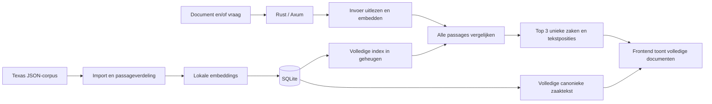

# Architectuurgids

## Huidige stand

**Werk in uitvoering:** de overstap naar BGE-small-en-v1.5, CLS-pooling, een queryinstructie en manifestformaat 2 is nog niet volledig geverifieerd. Een eerdere bulkimport is gestopt wegens geheugendruk; er is nog geen goedgekeurde verse BGE-index of kwaliteitsuitslag. De MiniLM-baseline van 0/15 en de evaluatiebestanden blijven bewaard. Zwaar werk volgt uitsluitend de afgesproken resourcegate. Dit zijn geen opgeleverde BGE-resultaten.

## Resourcecheckpoint vóór nieuwe modelmetingen

[embedding.rs](../backend/src/engine/embedding.rs) voert native inference nu uit met maximaal één tekst per call, met twee ONNX-threads. Iedere native call levert eerst de genormaliseerde vector op en laat zijn ruwe uitvoer los voordat de volgende tekst begint. Alleen een kleine interne batchgrootte meegeven aan één volledige corpuscall was onvoldoende: fastembed bewaart dan de ruwe uitvoer van alle interne batches tot de export. De nieuwe helper controleert ook het aantal teruggegeven rijen per call, behoudt de invoervolgorde en logt aantallen als voortgang zonder documentinhoud. De eerste bewaakte proef met vier teksten van ongeveer 465 tokens is bij de eerste inference gestopt op een gemeten groepspiek van 2637,64 MiB, zonder swapgroei. Daarom is de native grens aangescherpt naar één; de RSS-grens is niet verhoogd. Een nieuwe bewaakte modelproef moet de kleinere grens nog bevestigen.

De vaste-lengteproef met native grens één slaagde met een piek van 1415,45 MiB, maar de daaropvolgende volledige import stopte alsnog bij 12/578 teksten op de RSS-grens (werkelijke kindpiek 1625,36 MiB), zonder swapgroei. Daarom wordt de getypeerde CPU-provider nu expliciet met `with_arena_allocator(false)` geregistreerd; een registratiefout geeft een fout in plaats van stille fallback. Dit verandert geen modelgewichten, rollen, tokenbudget of scoring. De kleine resourceproef gebruikt nu wisselende korte, middellange en bijna-maximale lengtes in dezelfde sessie. De daaropvolgende bewaakte proef bepaalde of deze allocatie-instelling voldoende ruimte gaf vóór een nieuwe import.

De variabele-lengteproef met CPU-arena uit stopte op 1568,56 MiB. Daarom is als hardwareaanpassing de standaard statisch gequantiseerde BGE-small-variant gekozen: `BGESmallENV15Q`, repository `Qdrant/bge-small-en-v1.5-onnx-Q`, bestand `model_optimized.onnx`. Fastembed-metadata bevestigt statische quantisatie, CLS-pooling en 384 dimensies; modelrollen, 480-tokenbudget, native grens één, twee threads en arena uit blijven gelijk. De configuratie bewaart de quantisatiemodus in het SDK-veld en hasht het daadwerkelijke modelbestand. Een eerdere MiniLM- of FP32-configuratie kan hierdoor niet als dezelfde index worden gebruikt. De echte resource- en corpuschecks voor deze variant zijn nog niet uitgevoerd; de grenzen worden niet verhoogd. De bewaarde oorspronkelijke 0/15-meting blijft een indicatieve AI-beoordeling, geen menselijke juridische referentie.

[resource_guard.py](../backend/scripts/resource_guard.py) start precies één eigen procesgroep, meet elke seconde de gezamenlijke RSS van die groep en leest de macOS-geheugendruk en swap. Het script start alleen bij normale druk (`kern.memorystatus_vm_pressure_level = 1`) en stopt de eigen groep bij RSS vanaf 1536 MiB, niet-normale druk, swapgroei vanaf 128 MiB of de tijdslimiet. Meetfouten stoppen de job eveneens; andere gebruikersprocessen worden niet gesignaleerd. De grens voor één meting is maximaal 600 seconden. Het JSON-verslag bevat proces-ID's, monsters, piek-RSS en stopreden; logs en verslagen horen buiten Git. Modelchecks moeten één voor één draaien, met `--test-threads=1`.

De twee native-boundsregressies zijn rood en daarna groen uitgevoerd. De standaard Rust-run slaagde met vijftien deterministische tests; zes echte modelchecks blijven genegeerd. Twee Python-beleidstests en lichte succes-/timeoutprobes voor de watchdog slaagden. Dit bewijst nog geen veilige echte modelpiek of bruikbare juridische zoekkwaliteit. Daarvoor zijn een afzonderlijke resource-review, een kleine bewaakte modelsmoke en pas daarna een eventuele volledige import nodig. De oude kwaliteitsscore 0/15 blijft een bewaarde, ongewijzigde baseline.

De repo bevat het API-contract, synthetische fixtures, de geteste Axum-router en PDF/TXT-extractie, en de data-/zoekengine met corpusimport en SQLite-opslag. De server/CLI-koppeling bestaat. Deterministische tests en een echte TCP-doorloop met ontbrekende database zijn gecontroleerd; de volledige corpusdoorloop en onafhankelijke eindreview lopen nog. Frontendimplementatie valt buiten deze backendwijziging.

De React/TypeScript-frontend in [`frontend/`](../frontend/) werkt lokaal met Vite en synthetische [fixtures](examples/search-response.json). De frontend heeft een chatinvoer, PDF/TXT-bijlage, drie klikbare documentvoorbeelden onder de invoerbox en een aparte leesweergave met exacte tekstmarkeringen.

De [README](../README.md) is het startpunt; [AGENTS.md](../AGENTS.md) bepaalt hoe agents samenwerken. Het contract is een productafspraak. Deze gids legt de samenhang, afwegingen en grenzen uit.

## Geverifieerde bouwbasis

- [backend/Cargo.toml](../backend/Cargo.toml) en de lockfile vormen een zelfstandige Rust 2024-crate; er is geen rootworkspace. De directe COA-patronen zijn Axum 0.8, fastembed exact 7.1.2 met dezelfde native-TLS/ONNX-downloadfeatures, serde, Tokio en SHA-256.
- [backend/src/lib.rs](../backend/src/lib.rs) exporteert de HTTP-router, extractie, configuratie en de echte engine. [main.rs](../backend/src/main.rs) biedt `import`, `search` en `serve`.
- SQLite gebruikt de gebundelde SQLite-build via rusqlite. De HTTP-router gebruikt CORS en YAML-naar-JSON voor het canonieke OpenAPI-contract. PDF-extractie gebruikt pdf-extract; scans vereisen OCR en worden geweigerd.
- [.github/workflows/backend-checks.yml](../.github/workflows/backend-checks.yml) volgt de COA-checkvolgorde: expliciete Rust-toolchain, fmt, clippy, deterministische tests en build. De standaardchecks laden geen embeddingmodel.
- De gecontroleerde commando's staan in de [README](../README.md). Routertests gebruiken het COA-patroon met `tower::ServiceExt::oneshot` en echte responsebytes. Alleen de enginegrens wordt vervangen door de contractfixtures; deze tests bewijzen nog geen echte retrieval of TCP-doorloop.

## HTTP-invoer en tekstextractie

[api::router](../backend/src/api.rs) biedt de vier contractroutes en configureerbare CORS. `POST /api/search` leest de velden `query` en `document`, weigert dubbele/onbekende velden en behandelt een lege vraag als afwezig. Een ongeldig meegestuurd document wordt ook naast een geldige vraag geweigerd. Er is geen overgenomen COA-limiet van 1000 vraagtekens of 8192 requestbytes.

[extract_document](../backend/src/extraction.rs) behoudt UTF-8-TXT en extraheert tekst uit PDF. De bestandsgrootte wordt tijdens het lezen per document geteld: precies 10 MiB blijft geldig, los van multipartheaders. De vraag wordt tijdens het lezen op 1 MiB UTF-8 begrensd en de hele multipartrequest op 12 MiB. PDF-uitvoer wordt tijdens het schrijven op 20 MiB begrensd; een panic in de externe parser wordt een 422-fout. Dit is geen procesisolatie of harde CPU-/decompressiegrens voor de PDF-library.

PDF-parsing en enginewerk draaien via `spawn_blocking`; een mutex bewaakt de engine. Zonder geladen engine geven health, zoeken en zaakdetails 503; er is geen fictieve terugval. [ApiError](../backend/src/api_error.rs) levert het afgesproken JSON-foutformaat zonder interne enginediagnostiek.

[service.rs](../backend/src/service.rs) leest de instelbare database-/cachepaden, bindadres en CORS-origins. [main.rs](../backend/src/main.rs) laadt één engine bij `serve` en bindt standaard op `127.0.0.1:8000`. Een ontbrekende of ongeldige index start de router zonder engine, met 503 voor health, zoeken en zaakdetails; `/openapi.json` blijft beschikbaar. Na import is een serverherstart nodig. Het CLI-commando `search` gebruikt dezelfde engine en ranking als HTTP, zonder tweede implementatie.

## Geïmplementeerde data-/zoekengine

[engine/mod.rs](../backend/src/engine/mod.rs) verbindt import, opslag en zoeken. `import_corpus` leest de JSON-map; [corpus.rs](../backend/src/engine/corpus.rs) selecteert precies één majority opinion, gebruikt `decision_date` en bewaart het volledige oorspronkelijke JSON-record inclusief aanvullende opinions. Canonieke tekst normaliseert CRLF/CR naar LF en verwijdert uitsluitend omringende witruimte. `text_version` is SHA-256 van de UTF-8-bytes van die exacte tekst.

[chunk.rs](../backend/src/engine/chunk.rs) maakt overlappende passages met oorspronkelijke byte- en UTF-16-grenzen. Een kandidaat beslaat maximaal 1600 Unicode-tekens en wordt kleiner zolang de echte tokenizer meer dan 480 tokens telt, inclusief speciale tokens. De normale overlap is 160 tekens; bij korte passages blijft voorwaartse voortgang gegarandeerd. Er wordt geen tekst stil afgekapt. Zowel lange vragen als documenten worden volledig verdeeld; hun passagevectoren krijgen een opnieuw genormaliseerd gemiddelde.

[embedding.rs](../backend/src/engine/embedding.rs) hergebruikt de fastembed-instellingen en het gekwantiseerde meertalige MiniLM-model uit COA. Een procesbrede gedeelde ONNX-omgeving maakt meerdere modelinitialisaties mogelijk, ook na import en het laten vallen van de vorige sessie; de directe `ort`-dependency gebruikt dezelfde reeds transitief gelockte versie. Modeltruncatie staat uit; iedere embeddinginvoer wordt vooraf tegen het tokenbudget gecontroleerd. De configuratie registreert SDK, model, dimensies, limiet en SHA-256 van de daadwerkelijk gebruikte model-/tokenizerbestanden en cacherevisie. De modelcache is een instelbaar pad buiten Git. Juridische geschiktheid van dit model is nog niet inhoudelijk beoordeeld.

[storage.rs](../backend/src/engine/storage.rs) bewaart bronrecords, passages, vectorbytes en manifest in SQLite. Een herimport vervangt de index in één transactie. `Engine::load` leest uitsluitend een bestaande database en accepteert pas een snapshot na controle van alle 135 afgesproken case-identiteiten, volledige passagebedekking, tekstversies, UTF-16-grenzen, vectoraantallen/-dimensies, eindige niet-nulvectoren en integriteit van het volledige manifest. De vaste identiteitenhash is afgeleid van de lexicografisch gesorteerde case-ID's uit het aangeleverde corpus. De huidige modelconfiguratie moet exact overeenkomen; gewijzigde bestanden of configuratie vereisen herimport. De engine doet bij laden geen impliciete herindexering.

[ranking.rs](../backend/src/engine/ranking.rs) bevat de overgenomen COA-cosinusfunctie en haar numerieke regressietest, met bronverwijzing in het bestand. De nieuwe casegroepering volgt `cosine-max-v1`: alle passages vergelijken, maximum per zaak, vaste passage-/case-ID-ties en exact drie unieke zaken. Numeriek gelijke scores, inclusief positief en negatief nul, volgen dezelfde case-ID-tie-break. [types.rs](../backend/src/engine/types.rs) beschrijft de contractresponses. De engine levert de oorspronkelijke beste passage en volledige canonieke majority-tekst; hij genereert geen antwoord.

De deterministische tests controleren onder meer Unicode/overlap, drie invoermodi, lange vragen, casegroepering, beide tie-breaks, bronidentiteit, duplicaten, herimport, corrupte opslag en een partiële index met nog drie resterende zaken. Ze gebruiken bekende embeddingvectoren aan de modelgrens. De echte modeltest controleert daarnaast onverkorte tokenaantallen en vectorvorm. De afzonderlijke echte-corpuscheck importeert alle zaken en herlaadt de index, maar vervangt geen inhoudelijke beoordeling van zoekkwaliteit.

De onafhankelijk geschreven module `independent_reference_tests` in [ranking.rs](../backend/src/engine/ranking.rs) vergelijkt productie-uitkomsten met een volledige f64-referentieberekening zonder de productiecosinus of casegroepering aan te roepen. De voorbeelden controleren alle drie invoermodi, een beste zaak aan het einde van de invoer, passage- en caseties, omgekeerde invoervolgorde en scores van weggelaten zaken. Extra grensgevallen controleren ongeldige vectoren, minder dan drie zaken en de normalisatie van een gemiddelde documentvector. Deze modelvrije tests zijn in een afzonderlijke reviewtarget uitgevoerd; een gedeelde Cargo-target tussen worktrees bleek onbetrouwbaar voor testherkomst.

## Gebruik en geplande hoofdroute

Een gebruiker geeft een document en/of vraag. De app toont drie verschillende uitspraken, met per zaak de volledige tekst van het meerderheidsoordeel (majority opinion) en de best scorende passage gemarkeerd.

De mapverdeling is `backend/` voor de Rust-service en `frontend/` voor de aparte frontend-agent. Alleen de backend hoort bij deze wijziging. Gedeeld werk zit in `docs/`; contractwijzigingen worden afgestemd voordat een agent erop gaat bouwen.

## Bestaande frontend: invoer, documentvoorbeelden en leesweergave

[`frontend/src/main.tsx`](../frontend/src/main.tsx) kiest bij het starten een client en rendert de React-app. Standaard is dit de lokale mock in [`client.ts`](../frontend/src/client.ts); alleen `VITE_API_MODE=api` kiest de HTTP-client met configureerbare `VITE_API_BASE_URL` (standaard `http://127.0.0.1:8000`). Er zijn geen externe modelaanroepen, accounts of extra UI-libraries.

```mermaid
flowchart LR
  U[Eigen tekst en/of bijlage] --> A[React App: invoer en gesprek]
  A --> V[validateInput: bruikbare invoer, type en grootte]
  V --> M[Mockclient: vaste JSON-fixtures]
  M --> R[Drie documentvoorbeelden onder de invoerbox]
  R --> D[Klik opent aparte reader en haalt detail op]
  D --> G[Corpus-/tekstversie en exacte UTF-16-uitsnede controleren]
  G --> T[Volledige tekst met markering en brononderbouwing]
  T --> B[Terug naar resultaten en oorspronkelijke focus]
```

[`App` in `app.tsx`](../frontend/src/app.tsx) houdt de invoer, bijlage en laatste succesvolle zoekresponse alleen in browsergeheugen. De naam Mike, huidige vraag en invoerbox blijven het vertrekpunt. Een zoekopdracht blokkeert dubbele verzending tijdens laden en toont daaronder precies drie klikbare documentvoorbeelden. Op desktop staan ze naast elkaar; op smalle schermen onder elkaar. Een volgende succesvolle zoekopdracht vervangt de vorige resultaten. Er is geen stapelende chatgeschiedenis boven de invoerbox. Mislukte zoekopdrachten houden de invoer en eventuele vorige resultaten beschikbaar. Enter verstuurt, Shift+Enter maakt een nieuwe regel.

Klikken op een document opent `DocumentReader` als aparte leesweergave op dezelfde pagina. De invoer en resultaten zijn dan verborgen, niet verwijderd. De reader haalt de zaak pas op bij openen, toont laad-/foutstatus en negeert een nog lopende detailresponse na sluiten. De volledige aanwezige meerderheidstekst blijft onverkort beschikbaar in de gewone paginascroll. ‘Terug naar resultaten’ herstelt focus op het gekozen document en de eerdere scrollpositie; readeropenen verplaatst focus naar de documenttitel. Upload-, document- en terugknoppen hebben toegankelijke namen.

De voorbeelden gebruiken een sober pagina-icoon, zaakmetadata en een excerpt uit de exacte gevonden passage. Ze stellen geen originele PDF, officiële paginering of gerechtszegel voor. In de reader toont ‘Waarom dit document?’ die bronpassage en de overeenkomstscore. Dit is brononderbouwing, geen vergelijking met een aangewezen uploadpassage en geen gegenereerde juridische uitleg. Het huidige contract levert daarvoor geen velden. De mock meldt compact bij de resultaten dat het voorbeelden zijn en geen analyse van de invoer; ook de reader benoemt zijn onderbouwing als voorbeeld. Er zijn geen extra fictieve juridische verklaringen of nieuwe contractvelden toegevoegd.

[`validateInput` in `search.ts`](../frontend/src/search.ts) trimt de vraag en accepteert PDF/TXT-extensies tot en met 10 MiB. Lege bestanden en ongeldige meegegeven bestanden blokkeren ook een geldige vraag. De mock leest de bestandsinhoud niet: een verkeerd benoemde, onleesbare PDF of scan wordt hier niet inhoudelijk herkend. Dat blijft backendwerk. De mock past `mode` wel aan naar `query`, `document` of `combined`, maar geeft voor elke invoer dezelfde drie **synthetische** resultaten. Dit is geen implementatie of validatie van de juridische zoekmethode.

[`getPassageParts` in `search.ts`](../frontend/src/search.ts) vergelijkt corpusversie, tekstversie en zaak-ID en controleert dat de exacte UTF-16-uitsnede overeenkomt met `passage.text`. De bron wordt niet opnieuw genormaliseerd en React rendert tekst veilig met een `<mark>`. Bij oude versies of onjuiste posities toont de UI een fout met het verzoek opnieuw te zoeken; de gebruiker start die nieuwe opdracht zelf.

De HTTP-client gebruikt `FormData` zonder een eigen multipart-Content-Type, volgt de aangeboden `case_url` en toont backendfoutberichten. Deze code is met een onderschepte HTTP-grens getest; een echte backendintegratie is nog niet uitgevoerd. De API-schemas blijven vastgelegd in [OpenAPI](openapi.yaml).

Vanuit `frontend/`: `npm ci`, `npm run dev`, `npm test` en `npm run build`. De devserver bindt aan `127.0.0.1:5173`; Vite wisselt niet stilzwijgend naar een andere poort. Tests in [`search.test.ts`](../frontend/src/search.test.ts) controleren invoermodi, bestandgrenzen, mock/details, multipart en versie-/Unicode-markeringen; [`app.test.ts`](../frontend/src/app.test.ts) controleert de React-route van eigen tekst naar drie documenten onder de invoerbox, volledige veilige bronweergave en brononderbouwing, terugkeerfocus, vervanging van de vorige resultaten en herstel na invoer-/zoekfouten. De productiebuild voert ook TypeScript-controle uit. De lokale frontend is hiermee uitvoerbaar; de gezamenlijke API/UI-doorloop is nog niet afgerond. Backendimport en backendtests staan in de andere hoofdstukken beschreven.

## Corpus, opslag en index

Het lokale corpus staat in `/Users/R0GUE/Downloads/texas-criminal-reports`. De eerdere data-inspectie vond 135 historische uitspraken van het Texas Court of Criminal Appeals uit 1892–1893, volledige JSON-teksten en bijbehorende HTML. De volumemetadata vermeldt foutief 1992–1993; import gebruikt `decision_date` per zaak.

De import bewaart zaak-ID, metadata, bronidentificatie en oorspronkelijke opinion-typen. De eerste zoekindex gebruikt de majority opinion, het oordeel van de meerderheid. Concurrence en dissent blijven herkenbaar en worden niet ongemerkt met het meerderheidsoordeel vermengd.

SQLite bewaart zaken, canonieke tekst, passages en embeddings. Per zaak bepaalt `text_version` de versie van de canonieke tekst; `corpus_version` identificeert de complete geïmporteerde dataset en verwerking. Model, modelversie en passageverdeling worden bij de index vastgelegd. Herimport is herhaalbaar en mag geen dubbele zaken maken. Uploads worden alleen voor de zoekopdracht verwerkt en hoeven niet duurzaam te worden opgeslagen.

De hele index wordt bij serverstart in geheugen geladen. Readiness volgt pas nadat alle 135 afgesproken zaken en hun geldige passages aanwezig zijn. Een partiële of kapotte index geeft een fout; die mag niet als volledige top-driezoekfunctie worden gepresenteerd.

## Embeddings en zoekmethode

Corpus en invoer gebruiken hetzelfde lokale embeddingmodel via fastembed: het gekwantiseerde meertalige MiniLM uit COA, met dezelfde modelinstellingen als vertrekpunt. De model- en tokenizerbestanden worden bij de index vastgelegd. Geschiktheid voor juridisch Engels wordt afzonderlijk beoordeeld. Een modeldownload en compilatie kunnen nodig zijn; er is nog geen doorlooptijdbelofte.

Uitspraken en uploads worden in korte, deels overlappende passages verdeeld, binnen de invoerlimiet van het gekozen model. Tekstposities moeten naar de opgeslagen canonieke tekst blijven verwijzen. Niet stilzwijgend lange teksten afkappen.

De eerste rankingmethode, `cosine-max-v1`, werkt als volgt:

1. **Vraag:** cosinusovereenkomst tussen vraagvector en iedere corpuspassage.
2. **Document:** normaliseer het gemiddelde van de documentpassagevectoren opnieuw en vergelijk dat met iedere corpuspassage.
3. **Beide:** `0.7 * query_score + 0.3 * document_score`, met bovenstaande cosinusovereenkomsten.
4. Vergelijk alle passages. De score van een zaak is de hoogste passagescore binnen die zaak. Kies bij gelijke passagescores de laagste `passage_id` (lexicografisch).
5. Sorteer alle zaken op score aflopend; bij gelijke scores op `case_id` lexicografisch oplopend. Geef precies de eerste drie terug.

De gewichten zijn een voorlopige ontwerpkeuze, geen gevalideerd optimum. Nulvectoren en onbruikbare invoer mogen geen NaN-scores opleveren; geef dan een duidelijke fout.

Er is geen benaderende vectorindex of voorafgaande kandidaatselectie nodig bij deze corpusomvang. De harde garantie is **de drie hoogst scorende unieke zaken binnen de volledige afgesproken index, volgens deze methode**. Deze garantie zegt niet dat de drie zaken voor iedere juridische vraag inhoudelijk de meest relevante zijn. Er is nog geen gevalideerde ondergrens voor relevantie; een succesvolle zoekopdracht kan lage scores bevatten.

## Documenten en markeerbare passages

Het zoekresultaat geeft per zaak één originele passage, een stabiele passage-ID en `start_utf16`/`end_utf16` terug. Het detailendpoint geeft de volledige canonieke tekst van het meerderheidsoordeel; afwijkende of aanvullende opinions horen niet bij deze tekst. Tekstposities gelden voor die exacte tekst en `text_version`; het einde is exclusief. UTF-16-eenheden sluiten aan bij JavaScript `slice`, ook bij tekens buiten de BMP. Rust moet de eenheden expliciet bepalen; UTF-8-byteposities zijn niet uitwisselbaar met deze posities.

De backend normaliseert tekst één keer bij import, bewaart die tekst en berekent alle passagegrenzen daarop. De frontend normaliseert deze tekst niet opnieuw en controleert versies vóór het markeren. Dit levert leesbare volledige documenten met markeringen op; een originele PDF-layout of PDF-coördinaten zijn niet onderdeel van dit corpuscontract.

## Gericht hergebruik uit COA

De code-inspectie in `../coa` wees deze bestaande bouwstenen aan:

| Onderdeel | Gecontroleerd bestaand codepad | Betekenis voor deze app |
|---|---|---|
| Embeddings en zoeken | `../coa/src/lib.rs`, `Index::load`, `Index::search_with_top_k` | Zoekkern als vertrekpunt; ingebouwde datasetloader vervangen. |
| Cosinus en sortering | `../coa/src/ranking.rs` | Domeinonafhankelijke berekening gericht overnemen. |
| Eerst zoeken, dan modelcontext | `../coa/src/experiment/runner.rs`, `dense_once` | Alleen patroon; de experimentrunner niet meenemen. |
| Bron/citaatcontrole | `../coa/src/experiment/arms.rs`, `validate_answer` | Pas relevant bij een latere uitbreiding met antwoordgeneratie. |

Deze paden liggen buiten deze repo en zijn daarom oriëntatiepunten, geen beschikbare projectmodules. Verifieer de actuele COA-code opnieuw voordat je iets overneemt. De COA-parser verwerkt maximaal vijf ingebouwde Markdown-documenten en biedt geen algemene PDF-upload of SQLite-opslag. Codex-processen, MCP, activiteitprompts en experimentinfrastructuur worden niet overgenomen.

## Scope en beperkingen

- Alleen UTF-8-TXT en PDF met uitleesbare tekst. OCR voor scans is niet onderdeel van de eerste versie.
- Lokale embeddings en ophalen van zaken; geen gegenereerd juridisch advies en geen Orq- of Codex-aanroep nodig.
- Het corpus is klein en historisch; resultaten zijn geen volledig of actueel overzicht van Texas-rechtspraak.
- Een gemiddelde documentvector kan deelonderwerpen vervagen. De beste passage per zaak kan lange uitspraken bevoordelen. Beoordeel beide met inhoudelijke voorbeelden.
- Overeenkomende scores en tekstmarkeringen bewijzen geen juridische juistheid, volledigheid of toepasselijkheid.

## Verificatie bij implementatie

De bouwchecks staan in README en CI. De deterministische engine-/HTTP-tests en afzonderlijke lokale modelchecks staan hierboven beschreven. Onafhankelijke review en HTTP-integratie moeten de volledige oplevering aantoonbaar maken:

De frontendchecks staan in het frontendhoofdstuk. De gezamenlijke UI/API-doorloop wordt pas uitgevoerd na de resourceveilige backendvrijgave.

- alle drie invoermodi, PDF/TXT en duidelijke fouten bij onbruikbare invoer;
- precies drie unieke zaken, volledige scoring en deterministische gelijke scores;
- dezelfde corpus- en tekstversies, met UTF-16-posities die exact de aangeboden passage selecteren;
- herhaalbare import en dezelfde beschikbare index na herstart;
- onafhankelijke controle van ranking met bekende vectoren én aparte inhoudelijke beoordeling;
- een echte HTTP-upload, zoeken en ophalen van volledige documenten.

Contract- en fixturechecks moeten bij implementatie aansluiten op deze backend-CI. De documentatiebootstrap is handmatig gecontroleerd en onafhankelijk gereviewd; de canonieke documenten zijn nog geen mechanisch afgedwongen mergegate.

## Recente architectuurwijzigingen

- 2026-11-11: engine en API gekoppeld via dezelfde zelfstandige CLI/server. Echte TCP-readiness bij ontbrekende database gecontroleerd; volledige corpusdoorloop en onafhankelijke eindreview nog gaande.

- 2026-11-11: operationele grenzen expliciet afgestemd: query 1 MiB, multipart 12 MiB en PDF-tekst 20 MiB; documentlimiet blijft 10 MiB. Geen truncatie; parserpanics worden onleesbare-documentfouten.

- 2026-11-11: geteste HTTP-router, CORS, OpenAPI-response en PDF/TXT-extractie toegevoegd. Echte engine/serverkoppeling volgt; geen modelkwaliteit of TCP-doorloop geclaimd.

- 2026-11-11: twee onafhankelijke modelvrije referentietests toegevoegd voor de gekozen rankingmethode en numerieke foutgevallen. Alle dertien deterministische enginetests geslaagd in een eigen reviewtarget; dit is geen juridische kwaliteitsgarantie.
- 2026-11-11: zelfstandige data-/zoekengine toegevoegd met gerichte COA-hergebruikverwijzingen, SQLite-snapshot, volledige corpusidentiteitscontrole, tokenbewuste Unicodepassages en exacte top drie. Elf deterministische tests en de lokale modelgrenscheck uitgevoerd; HTTP-service en inhoudelijke kwaliteitsvalidatie volgen afzonderlijk.

- 2026-11-11: zelfstandige Rust-library, vaste dependency-lockfile en backend-CI toegevoegd op een featurebranch. Nog geen productgedrag of draaiende server; API-contract ongewijzigd.

- 2026-11-11: documentpresentatie herzien: laatste zoekresultaten onder de invoerbox, drie pagina-voorbeelden en een aparte volledige reader met terugkeerfocus. Bronpassage en score vormen de onderbouwing; de simulatie voegt geen juridische vergelijkredenen toe.

- 2026-11-11: minimale React/TypeScript-chatfrontend met Vite toegevoegd. Lokale mock en toekomstige HTTP-client zijn gescheiden; eigen tekst/bijlage, laad-/foutstatus, drie synthetische documenten en versiegecontroleerde UTF-16-markeringen zijn lokaal geïmplementeerd. De backendkoppeling en indicatieve zoekkwaliteit worden afzonderlijk gecontroleerd.

- 2026-11-11: repo-overdracht en API-ontwerp toegevoegd. Scope vastgelegd als document en/of vraag, exact drie unieke zaken en volledige majority-opinionteksten met UTF-16-markeerposities. Nog geen runtime-implementatie.
