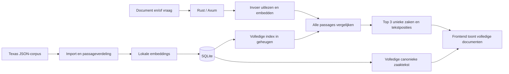
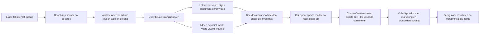

# Architectuurgids

## Huidige stand

De Rust-backend en gemergde React-frontend zijn beschikbaar in deze repository. De statisch gequantiseerde BGE-index is onder de resourceguard berekend: 135 zaken en 578 passages. De gezamenlijke live UI/API-controle is onafhankelijk afgerond: de gewone frontend op 5173 gebruikt nu standaard de bewaakte backend op 8000. De aparte API-preview op 5174 kan daarnaast draaien; fixtures vereisen een expliciete mockkeuze. De oorspronkelijke MiniLM-meting van 0/15 blijft bewaard als indicatieve AI-evaluatie; zij is geen menselijke juridische referentie. Er is geen A/B/C-uitbreiding of top-vijfcontract ingevoerd.

De [evaluatieviewer](evals/index.html) toont 25 concrete ontwerpbeschrijvingen. Gecontroleerde kandidaatlabels, een benchmarkrunner en bijbehorende meetresultaten ontbreken nog.

## Resourcecheckpoint vóór nieuwe modelmetingen

[embedding.rs](../backend/src/engine/embedding.rs) voert native inference nu uit met maximaal één tekst per call, met twee ONNX-threads. Iedere native call levert eerst de genormaliseerde vector op en laat zijn ruwe uitvoer los voordat de volgende tekst begint. Alleen een kleine interne batchgrootte meegeven aan één volledige corpuscall was onvoldoende: fastembed bewaart dan de ruwe uitvoer van alle interne batches tot de export. De nieuwe helper controleert ook het aantal teruggegeven rijen per call, behoudt de invoervolgorde en logt aantallen als voortgang zonder documentinhoud. De eerste bewaakte proef met vier teksten van ongeveer 465 tokens is bij de eerste inference gestopt op een gemeten groepspiek van 2637,64 MiB, zonder swapgroei. Daarom is de native grens aangescherpt naar één; de RSS-grens is niet verhoogd. De kleinere grens is vervolgens in de onderstaande bewaakte proeven onderzocht.

De vaste-lengteproef met native grens één slaagde met een piek van 1415,45 MiB, maar de daaropvolgende volledige import stopte alsnog bij 12/578 teksten op de RSS-grens (werkelijke kindpiek 1625,36 MiB), zonder swapgroei. Daarom wordt de getypeerde CPU-provider nu expliciet met `with_arena_allocator(false)` geregistreerd; een registratiefout geeft een fout in plaats van stille fallback. Dit verandert geen modelgewichten, rollen, tokenbudget of scoring. De kleine resourceproef gebruikt nu wisselende korte, middellange en bijna-maximale lengtes in dezelfde sessie. De daaropvolgende bewaakte proef bepaalde of deze allocatie-instelling voldoende ruimte gaf vóór een nieuwe import.

De variabele-lengteproef met CPU-arena uit stopte op 1568,56 MiB. Daarom is als hardwareaanpassing de standaard statisch gequantiseerde BGE-small-variant gekozen: `BGESmallENV15Q`, repository `Qdrant/bge-small-en-v1.5-onnx-Q`, bestand `model_optimized.onnx`. Fastembed-metadata bevestigt statische quantisatie, CLS-pooling en 384 dimensies; modelrollen, 480-tokenbudget, native grens één, twee threads en arena uit blijven gelijk. De configuratie bewaart de quantisatiemodus in het SDK-veld en hasht het daadwerkelijke modelbestand. Een eerdere MiniLM- of FP32-configuratie kan hierdoor niet als dezelfde index worden gebruikt. De bewaakte volledige import van deze variant slaagde in 90,06 seconden met 135 zaken en 578 passages, piek-RSS 1105,86 MiB, normale geheugendruk en geen swapgroei. De geheugenlimieten zijn niet verhoogd. Manifestformaat 2 bindt de verse index aan model, quantisatie, pooling, queryinstructie en modelbestanden; oudere MiniLM- en FP32-databases zijn geen geldige terugval. De bewaarde oorspronkelijke 0/15-meting blijft een indicatieve AI-beoordeling, geen menselijke juridische referentie.

[resource_guard.py](../backend/scripts/resource_guard.py) start precies één eigen procesgroep, meet elke seconde de gezamenlijke RSS van die groep en leest de macOS-geheugendruk en swap. Het script start alleen bij normale druk (`kern.memorystatus_vm_pressure_level = 1`) en stopt de eigen groep bij RSS vanaf 1536 MiB, niet-normale druk, swapgroei vanaf 128 MiB of de tijdslimiet. Meetfouten stoppen de job eveneens; andere gebruikersprocessen worden niet gesignaleerd. Gewone modelchecks en imports blijven begrensd op maximaal 600 seconden. Alleen `--serve-preview` met precies een concreet pad naar `texas-case-finder` gevolgd door `serve` staat een bewaakte preview tot 7200 seconden toe; shell-/Cargo-wrappers en PATH-aliassen zijn uitgesloten. Geheugen-, druk-, swap- en stopgedrag veranderen daarbij niet. Het JSON-verslag bevat proces-ID's, monsters, piek-RSS en stopreden; logs en verslagen horen buiten Git. Modelchecks moeten één voor één draaien, met `--test-threads=1`.

De twee native-boundsregressies zijn rood en daarna groen uitgevoerd. De standaard Rust-run slaagde met vijftien deterministische tests; zes echte modelchecks blijven genegeerd. De Python-beleidstests beschermen de geheugen- en timeoutgrenzen; drie extra regressies testen de expliciete previewtoestemming en afwijzing van wrappers/aliassen. Zij starten geen model of systeemprobe en draaien ook in de backend-CI. De kleine modelsmoke en volledige import zijn onder de guard uitgevoerd; de gezamenlijke live demo is onafhankelijk gecontroleerd en de afzonderlijke AI-doelmatchindicatie is vastgelegd. Deze technische controles bewijzen geen juridische relevantie. De oude kwaliteitsscore 0/15 blijft een bewaarde, ongewijzigde baseline.

De repo bevat het API-contract, synthetische fixtures, de geteste Axum-router en PDF/TXT-extractie, en de data-/zoekengine met corpusimport en SQLite-opslag. De server/CLI-koppeling bestaat. Deterministische tests en een echte TCP-doorloop met ontbrekende database zijn gecontroleerd; de nieuwe BGE-index is vooraf berekend en de gezamenlijke UI/API-eindcontrole is afgerond. Frontendimplementatie valt buiten deze backendwijziging.

De React/TypeScript-frontend in [`frontend/`](../frontend/) werkt lokaal met Vite en kiest standaard de echte lokale API. Synthetische [fixtures](examples/search-response.json) blijven uitsluitend beschikbaar in expliciete mockmodus. De frontend heeft een chatinvoer, PDF/TXT-bijlage, drie klikbare documentvoorbeelden onder de invoerbox en een aparte leesweergave met exacte tekstmarkeringen.

De [README](../README.md) is het startpunt; [AGENTS.md](../AGENTS.md) bepaalt hoe agents samenwerken. Het contract is een productafspraak. Deze gids legt de samenhang, afwegingen en grenzen uit.

## Geverifieerde bouwbasis

- [backend/Cargo.toml](../backend/Cargo.toml) en de lockfile vormen een zelfstandige Rust 2024-crate; er is geen rootworkspace. De directe COA-patronen zijn Axum 0.8, fastembed exact 7.1.2 met dezelfde native-TLS/ONNX-downloadfeatures, serde, Tokio en SHA-256.
- [backend/src/lib.rs](../backend/src/lib.rs) exporteert de HTTP-router, extractie, configuratie en de echte engine. [main.rs](../backend/src/main.rs) biedt `import`, `search` en `serve`.
- SQLite gebruikt de gebundelde SQLite-build via rusqlite. De HTTP-router gebruikt CORS en YAML-naar-JSON voor het canonieke OpenAPI-contract. PDF-extractie gebruikt pdf-extract; scans vereisen OCR en worden geweigerd.
- [.github/workflows/backend-checks.yml](../.github/workflows/backend-checks.yml) volgt de COA-checkvolgorde: expliciete Rust-toolchain, fmt, clippy, deterministische tests en build. De standaardchecks laden geen embeddingmodel.
- De gecontroleerde commando's staan in de [README](../README.md). Routertests gebruiken het COA-patroon met `tower::ServiceExt::oneshot` en echte responsebytes. Alleen de enginegrens wordt vervangen door de contractfixtures; deze tests bewijzen nog geen echte retrieval of TCP-doorloop.

## HTTP-invoer en tekstextractie

[api::router](../backend/src/api.rs) biedt de vier contractroutes en configureerbare CORS. `POST /api/search` leest de velden `query` en `document`, weigert dubbele/onbekende velden en behandelt een lege vraag als afwezig. Een ongeldig meegestuurd document wordt ook naast een geldige vraag geweigerd. Er is geen overgenomen COA-limiet van 1000 vraagtekens of 8192 requestbytes.

[extract_document](../backend/src/extraction.rs) behoudt UTF-8-TXT en extraheert tekst uit PDF. De bestandsgrootte wordt tijdens het lezen per document geteld: precies 10 MiB blijft geldig, los van multipartheaders. De vraag wordt tijdens het lezen op 1 MiB UTF-8 begrensd en de hele multipartrequest op 12 MiB. PDF-uitvoer wordt tijdens het schrijven op 20 MiB begrensd; een panic in de externe parser wordt een 422-fout. Dit is geen procesisolatie of harde CPU-/decompressiegrens voor de PDF-library.

PDF-parsing en enginewerk draaien via `spawn_blocking`; een mutex bewaakt de engine. Zonder geladen engine geven health, zoeken en zaakdetails 503; er is geen fictieve terugval. [ApiError](../backend/src/api_error.rs) levert het afgesproken JSON-foutformaat zonder interne enginediagnostiek.

[service.rs](../backend/src/service.rs) leest de instelbare database-/cachepaden, bindadres en CORS-origins. [main.rs](../backend/src/main.rs) laadt één engine bij `serve` en bindt standaard op `127.0.0.1:8000`. Een ontbrekende of ongeldige index start de router zonder engine, met 503 voor health, zoeken en zaakdetails; `/openapi.json` blijft beschikbaar. Na import is een serverherstart nodig. Het CLI-commando `search` gebruikt dezelfde engine en ranking als HTTP, zonder tweede implementatie.

## Geïmplementeerde data-/zoekengine

[engine/mod.rs](../backend/src/engine/mod.rs) verbindt import, opslag en zoeken. `import_corpus` leest de JSON-map; [corpus.rs](../backend/src/engine/corpus.rs) selecteert precies één majority opinion, gebruikt `decision_date` en bewaart het volledige oorspronkelijke JSON-record inclusief aanvullende opinions. Canonieke tekst normaliseert CRLF/CR naar LF en verwijdert uitsluitend omringende witruimte. `text_version` is SHA-256 van de UTF-8-bytes van die exacte tekst.

[chunk.rs](../backend/src/engine/chunk.rs) maakt overlappende passages met oorspronkelijke byte- en UTF-16-grenzen. Een kandidaat beslaat maximaal 1600 Unicode-tekens en wordt kleiner zolang de echte tokenizer meer dan 480 tokens telt, inclusief speciale tokens. De normale overlap is 160 tekens; bij korte passages blijft voorwaartse voortgang gegarandeerd. Er wordt geen tekst stil afgekapt. Zowel lange vragen als documenten worden volledig verdeeld; hun passagevectoren krijgen een opnieuw genormaliseerd gemiddelde.

[embedding.rs](../backend/src/engine/embedding.rs) hergebruikt het lokale fastembed-/cachepatroon uit COA, met nu `BGESmallENV15Q` voor Engels. De gekozen BGE-small-en-v1.5-variant gebruikt CLS-pooling en 384 dimensies. Alleen vraagpassages krijgen de instructie `Represent this sentence for searching relevant passages: `; corpus- en documentpassages niet. Het tokenbudget telt die instructie mee en truncatie staat uit. Een procesbrede gedeelde ONNX-omgeving maakt meerdere modelinitialisaties mogelijk, ook na import en het laten vallen van de vorige sessie; de directe `ort`-dependency gebruikt dezelfde reeds transitief gelockte versie. Modeltruncatie staat uit; iedere embeddinginvoer wordt vooraf tegen het tokenbudget gecontroleerd. De configuratie registreert SDK, model, dimensies, limiet en SHA-256 van de daadwerkelijk gebruikte model-/tokenizerbestanden en cacherevisie. De modelcache is een instelbaar pad buiten Git. De zoekkwaliteit heeft uitsluitend een indicatieve AI-evaluatie, zonder menselijke juridische ijking.

[storage.rs](../backend/src/engine/storage.rs) bewaart bronrecords, passages, vectorbytes en manifest in SQLite. Een herimport vervangt de index in één transactie. `Engine::load` leest uitsluitend een bestaande database en accepteert pas een snapshot na controle van alle 135 afgesproken case-identiteiten, volledige passagebedekking, tekstversies, UTF-16-grenzen, vectoraantallen/-dimensies, eindige niet-nulvectoren en integriteit van het volledige manifest. De vaste identiteitenhash is afgeleid van de lexicografisch gesorteerde case-ID's uit het aangeleverde corpus. De huidige modelconfiguratie moet exact overeenkomen; gewijzigde bestanden of configuratie vereisen herimport. De engine doet bij laden geen impliciete herindexering.

[ranking.rs](../backend/src/engine/ranking.rs) bevat de overgenomen COA-cosinusfunctie en haar numerieke regressietest, met bronverwijzing in het bestand. De nieuwe casegroepering volgt `cosine-max-v1`: alle passages vergelijken, maximum per zaak, vaste passage-/case-ID-ties en exact drie unieke zaken. Numeriek gelijke scores, inclusief positief en negatief nul, volgen dezelfde case-ID-tie-break. [types.rs](../backend/src/engine/types.rs) beschrijft de contractresponses. De engine levert de oorspronkelijke beste passage en volledige canonieke majority-tekst; hij genereert geen antwoord.

De deterministische tests controleren onder meer Unicode/overlap, drie invoermodi, lange vragen, casegroepering, beide tie-breaks, bronidentiteit, duplicaten, herimport, corrupte opslag en een partiële index met nog drie resterende zaken. Ze gebruiken bekende embeddingvectoren aan de modelgrens. De echte modeltest controleert daarnaast onverkorte tokenaantallen en vectorvorm. De afzonderlijke echte-corpuscheck importeert alle zaken en herlaadt de index, maar vervangt geen inhoudelijke beoordeling van zoekkwaliteit.

De onafhankelijk geschreven module `independent_reference_tests` in [ranking.rs](../backend/src/engine/ranking.rs) vergelijkt productie-uitkomsten met een volledige f64-referentieberekening zonder de productiecosinus of casegroepering aan te roepen. De voorbeelden controleren alle drie invoermodi, een beste zaak aan het einde van de invoer, passage- en caseties, omgekeerde invoervolgorde en scores van weggelaten zaken. Extra grensgevallen controleren ongeldige vectoren, minder dan drie zaken en de normalisatie van een gemiddelde documentvector. Deze modelvrije tests zijn in een afzonderlijke reviewtarget uitgevoerd; een gedeelde Cargo-target tussen worktrees bleek onbetrouwbaar voor testherkomst.

## Gebruik en geplande hoofdroute

Een gebruiker geeft een document en/of vraag. De app toont drie verschillende uitspraken, met per zaak de volledige tekst van het meerderheidsoordeel (majority opinion) en de best scorende passage gemarkeerd.

De mapverdeling is `backend/` voor de Rust-service en `frontend/` voor de aparte frontend-agent. Alleen de backend hoort bij deze wijziging. Gedeeld werk zit in `docs/`; contractwijzigingen worden afgestemd voordat een agent erop gaat bouwen.

## Bestaande frontend: invoer, documentvoorbeelden en leesweergave

[`frontend/src/main.tsx`](../frontend/src/main.tsx) kiest bij het starten een client en rendert de React-app. [`createSearchRuntime` in `runtime.ts`](../frontend/src/runtime.ts) kiest standaard de HTTP-client in [`client.ts`](../frontend/src/client.ts), met configureerbare `VITE_API_BASE_URL` (standaard `http://127.0.0.1:8000`). Uitsluitend `VITE_API_MODE=mock` kiest de lokale fixtureclient; onbekende of ontbrekende moduswaarden selecteren nooit fixtures. API-, index- en netwerkfouten worden doorgegeven aan de bestaande foutweergave, zonder terugval naar verzonnen resultaten. Er zijn geen externe modelaanroepen, accounts of extra UI-libraries.

[`App` in `app.tsx`](../frontend/src/app.tsx) houdt de invoer, bijlage en laatste succesvolle zoekresponse alleen in browsergeheugen. De naam Mike, huidige vraag en invoerbox blijven het vertrekpunt. Een zoekopdracht blokkeert dubbele verzending tijdens laden en toont daaronder precies drie klikbare documentvoorbeelden. Op desktop staan ze naast elkaar; op smalle schermen onder elkaar. Een volgende succesvolle zoekopdracht vervangt de vorige resultaten. Er is geen stapelende chatgeschiedenis boven de invoerbox. Mislukte zoekopdrachten houden de invoer en eventuele vorige resultaten beschikbaar. Enter verstuurt, Shift+Enter maakt een nieuwe regel.

Klikken op een document opent `DocumentReader` als aparte leesweergave op dezelfde pagina. De invoer en resultaten zijn dan verborgen, niet verwijderd. De reader haalt de zaak pas op bij openen, toont laad-/foutstatus en negeert een nog lopende detailresponse na sluiten. De volledige aanwezige meerderheidstekst blijft onverkort beschikbaar in de gewone paginascroll. ‘Terug naar resultaten’ herstelt focus op het gekozen document en de eerdere scrollpositie; readeropenen verplaatst focus naar de documenttitel. Upload-, document- en terugknoppen hebben toegankelijke namen.

De voorbeelden gebruiken een sober pagina-icoon, zaakmetadata en een excerpt uit de exacte gevonden passage. Ze stellen geen originele PDF, officiële paginering of gerechtszegel voor. In de reader staat één compacte toelichting boven de volledige tekst; de gevonden passage is uitsluitend in die volledige tekst gemarkeerd, zonder herhaalde quote, spronglink of score in het uitlegblok. De gewone API levert brononderbouwing; de optionele Orq-adapter voegt gevalideerde modeltoelichting toe. Die toelichting vergelijkt geen aangewezen uploadpassage, omdat uploadinhoud niet aan het taalmodel wordt gegeven. De mock meldt compact bij de resultaten dat het voorbeelden zijn en geen analyse van de invoer; ook de reader benoemt zijn onderbouwing als voorbeeld. De frontend verzint zelf geen juridische verklaringen; extra toelichting komt uitsluitend uit de optionele, gevalideerde Orq-response.

[`validateInput` in `search.ts`](../frontend/src/search.ts) trimt de vraag en accepteert PDF/TXT-extensies tot en met 10 MiB. Lege bestanden en ongeldige meegegeven bestanden blokkeren ook een geldige vraag. De mock leest de bestandsinhoud niet: een verkeerd benoemde, onleesbare PDF of scan wordt hier niet inhoudelijk herkend. Dat blijft backendwerk. De mock past `mode` wel aan naar `query`, `document` of `combined`, maar geeft voor elke invoer dezelfde drie **synthetische** resultaten. Dit is geen implementatie of validatie van de juridische zoekmethode.

[`getPassageParts` in `search.ts`](../frontend/src/search.ts) vergelijkt corpusversie, tekstversie en zaak-ID en controleert dat de exacte UTF-16-uitsnede overeenkomt met `passage.text`. De bron wordt niet opnieuw genormaliseerd en React rendert tekst veilig met een `<mark>`. Bij oude versies of onjuiste posities toont de UI een fout met het verzoek opnieuw te zoeken; de gebruiker start die nieuwe opdracht zelf.

De HTTP-client gebruikt `FormData` zonder een eigen multipart-Content-Type, volgt de aangeboden `case_url` en toont backendfoutberichten. Naast de tests met onderschepte HTTP-grens is de echte browser/backendintegratie uitgevoerd: query/TXT/PDF/combinatie, drie volledige brondocumenten met markeringen en herstel na een 422-fout. De API-schemas blijven vastgelegd in [OpenAPI](openapi.yaml).

Vanuit `frontend/`: `npm ci`, `npm run dev`, `npm test` en `npm run build`. De devserver bindt aan `127.0.0.1:5173`; Vite wisselt niet stilzwijgend naar een andere poort. Tests in [`search.test.ts`](../frontend/src/search.test.ts) controleren invoermodi, bestandgrenzen, mock/details, multipart en versie-/Unicode-markeringen; [`app.test.ts`](../frontend/src/app.test.ts) controleert de React-route van eigen tekst naar drie documenten onder de invoerbox, volledige veilige bronweergave en brononderbouwing, terugkeerfocus, vervanging van de vorige resultaten en herstel na invoer-/zoekfouten. De productiebuild voert ook TypeScript-controle uit. De lokale frontend en gezamenlijke API/UI-doorloop zijn hiermee gecontroleerd. De gewone frontend op 5173 kiest standaard API; een extra expliciete API-preview kan op 5174 draaien. `npm run dev:mock` is een aparte opt-in voor fictieve resultaten en gebruikt eveneens 5173. [`runtime.test.ts`](../frontend/src/runtime.test.ts) beschermt standaard-APIkeuze, expliciete mockkeuze en foutdoorgifte zonder fixtureterugval. Backendimport en backendtests staan in de andere hoofdstukken beschreven.

## Optionele Orq-toelichting

[`backend/scripts/orq_proxy.py`](../backend/scripts/orq_proxy.py) is een aparte Python-stdlib-server op 18000, geen vervanging van de Rust-engine. Hij hergebruikt de bestaande HTTP-zoekbackend op 8000 en laadt geen index of embeddingmodel. De frontendpreview op 5175 wijst expliciet naar deze adapter; de gewone frontend/API blijven afzonderlijk bestaan.

De adapter geeft de vraag en aanwezigheid van een upload aan het gekozen Orq-model. Het model moet eenmaal `search_cases` aanroepen met lege argumenten. De applicatie koppelt dat verzoek aan de oorspronkelijke multipartbytes en stuurt die ongewijzigd naar Rust. Een tweede modelrequest bevat de werkelijk gevonden drie zaken en passages en vraagt om drie korte verklaringen met bestaande case-/passage-ID’s. De server valideert exacte identiteit, aantal en schemagrens en voegt zelf de oorspronkelijke passage als citaat toe. De oorspronkelijke resultaten, volgorde, scores en bronversies worden niet door het model aangepast. Er is geen reranking of vrije vervolgzoekloop.

De HTTP-uitbreiding is optioneel en achterwaarts compatibel: `explanation_status` en per resultaat `explanation` staan in [OpenAPI](openapi.yaml). De sidecar serveert zijn uitgebreide runtimecontract op `/openapi.json`; health en volledige zaakteksten komen van de bestaande backend. Provider-/schemafouten geven echte zoekresultaten met `unavailable`, nooit fictieve zoekresultaten. De reader toont gevalideerde modeltekst en noodzakelijke beperkingen samen in één compacte paragraaf boven de volledige meerderheidstekst. Dezelfde bronpassage wordt daar niet nogmaals geciteerd; de markering in de volledige tekst blijft behouden. Bronverwijzingen blijven in de gevalideerde API-response aanwezig. Corpus-/tekstversie en UTF-16-markering blijven de bestaande controles gebruiken.

De sleutel wordt uitsluitend serverzijdig uit `ORQ_API_KEY` of een privé `ORQ_API_KEY_FILE` buiten Git geladen. Uploadbytes gaan alleen naar de eigen zoekbackend, niet naar Orq; de modeluitleg krijgt bij uploads een vaste beperking daarover. Vragen en corpuspassages gaan wel naar de externe modelroute. Orq krijgt `store: false`; gateway-/providerretentie is hiermee niet geaudit. De adapter staat één zoekopdracht tegelijk toe, maximaal twee modelrequests per opdracht, 30 seconden provider-timeout, 128 KiB providerinvoer, 1 MiB providerantwoord en een eindig procesbudget (standaard twintig requests). De echte bestaande modelserver en zijn resourceguard worden niet door de sidecar beheerd.

De exacte modelroute `openai/gpt-4.1-mini-2025-04-14` is via de live catalogus en een kleine tool-/structured-outputpreflight gecontroleerd; `ORQ_MODEL` of `--model` kan haar wijzigen. Andere modelroutes zijn niet automatisch gevalideerd. [`test_orq_proxy.py`](../backend/scripts/test_orq_proxy.py) controleert toolvolgorde, ongewijzigde invoer/resultaten, bron-ID’s/citaten, foutdoorgifte, uploadcontext, bestandstatussen en runtimecontract zonder providerrequests. Startinstructies staan in README. Dit is geen juridische kwaliteitsevaluatie.

## Evaluatiedocumentatie en viewer

[EVALUATIEOPDRACHT.md](EVALUATIEOPDRACHT.md) is de canonieke specificatie van de beoordelingsafspraken. [evals/scenarios.json](evals/scenarios.json) bevat 25 concrete ontwerpbeschrijvingen met invoermodus, bronzaak, exact invoerfragment, Engelse zoekvraag waar van toepassing, verwacht juridisch gedrag en onderbouwing. [evals/index.html](evals/index.html) is de gegenereerde, klikbare leesweergave uit beide bronnen. De viewer hoort bij de projectdocumentatie en staat los van de React-productinterface en de synthetische productfixtures.

Het startoverzicht toont alle 25 ontwerp-evals als compacte rijen met ID, titel en invoermodus. Een klik toont de concrete input, het verwachte gedrag, waarom dit wordt getest en het bronbewijs. Bij query-only staat de bronzaak alleen onder herkomst; de exacte Engelse vraag is de invoer en de Nederlandse versie uitsluitend een leesvertaling. Bij documentinvoer verwijzen veld en SHA-256 naar de volledige majority opinion; de zichtbare quote is een leesfragment. Testcategorieën, varianten en de volledige opdracht staan secundair onder Afspraken.

[evals/build.py](evals/build.py) maakt de HTML uit de canonieke opdracht en scenariocatalogus. De generator controleert onder meer scenario-ID’s, verplichte inhoud en invoermodi; hij beoordeelt geen juridische kandidaatmatches. Voer vanuit de reporoot `python3 docs/evals/build.py` uit na inhoudswijzigingen; `python3 docs/evals/build.py --check` controleert of de opgeslagen weergave nog overeenkomt. Generatorchecks draaien met `python3 -m unittest discover -s docs/evals -p 'test_*.py'`. Onderhoud bron en afgeleide HTML in dezelfde changeset. De [AGENTS-afspraken](../AGENTS.md#evaluatiedocumentatie-onderhouden) bepalen hoe toekomstige wijzigingen aan invoermodi, beoordelingsregels, status, labels en runs worden verwerkt.

[De documentatieworkflow](../.github/workflows/eval-docs-checks.yml) voert synchronisatie- en generatorchecks uit op pull requests en pushes naar `main` die de bron, viewerbestanden of workflow veranderen. De check genereert niet eerst opnieuw: verouderde opgeslagen HTML faalt dus zichtbaar. Er worden geen corpusdata, modellen of benchmarkruns geladen.

De viewer presenteert concrete ontwerpbeschrijvingen, geen beoordeelde retrievalbenchmark of gemeten scores. Kandidaten met gecontroleerde relevantielabels, een metriekberekening en een uitvoerbare evaluatierunner moeten nog worden gebouwd. De zichtbare ontwerpen zijn ontwikkelmateriaal en kunnen niet als verborgen testset worden gepresenteerd. Een statische HTML-pagina start geen lokaal backendproces. De generatiecheck controleert alleen documentatiesynchronisatie; daadwerkelijke retrievalkwaliteit vraagt later onafhankelijke labels en echte runs volgens de opdracht.

### Evals uitvoeren op de lokale pagina

[`evals_web.py`](../backend/scripts/evals_web.py) serveert uitsluitend de evaluatie-HTML/JS/CSS/JSON op `127.0.0.1:8798`. `GET /api/evals` geeft de vaste B1-referentiecontrole en `E06` uit de canonieke scenariocatalogus. `POST /api/evals/{id}/run` accepteert alleen dezelfde lokale origin en een leeg JSON-object. Een globale lock staat één run tegelijk toe; een tweede verzoek krijgt 409. De overige 24 scenario’s blijven ontwerpen, zonder uitvoerroute. De kaart toont Input en Verwachte output; uitleg en schaal 0–3 staan achter de i-knop. De titel bevat geen E06-prefix, en invoermodus, Nederlandse leesvertaling en een status vóór uitvoering worden niet getoond. Na uitvoering telt een AI-samenvatting grades 2 en 3 als bruikbaar; dit is geen benchmarkscore of geslaagd/gefaald-oordeel. De header sluit aan op Mike met links “Mike / Evaluaties” en zonder rechteracties; de 25 scenario-ontwerpen staan ingeklapt onder de uitvoerbare E06 en blijven via hun links bereikbaar.

[`deterministic_b1.py`](../backend/scripts/deterministic_b1.py) vergelijkt de drie resultaten van de gewone bestaande Rust-API op 8000 met twee vooraf vastgelegde zaak-ID’s. [De B1-fixture](evals/deterministic_b1.json), afzonderlijk vastgelegd in commit `f3d80b6` vóór de eerste run, hergebruikt exact een vraag uit de eerdere queryset en verwacht ongeordend Cummings156040 en Neubauer156042. Bronhashes, UTF-16-bewijs en indexcontext worden gecontroleerd. Geen document, case-exclusion of AI-aanroep wordt gebruikt. Drie geldige unieke corpusresultaten en beide targets leveren 2/2 en `passed: true`; een ontbrekende target levert eerlijk `passed: false`. Ongeldige IDs, duplicaten, metadata of corpus-/rankingversies zijn technische fouten. Een andere match blijft onbeoordeeld. De UI toont de vaste verwachtingen, hun gevonden rang en alle drie werkelijke zoekresultaten. Dit is een deterministische doel-ID-controle met agentvoorgestelde referenties, geen volledige juridische goldset of precisieclaim.

B1 vereist geen Orq-key. Zonder `ORQ_API_KEY` start de server direct; alleen `--ask-key` vraagt expliciet een optionele credential voor E06. De credentialcheck op de runroute geldt uitsluitend voor E06. De bestaande globale runlock voorkomt gelijktijdige runs. De gewone Rustserver blijft onder zijn bestaande resourceguard; B1 start geen tweede native modelproces. Het runartefact bewaart fixtureversie/-hash, exacte invoer, zoekresponse, vaste vergelijking en corpus-/rankingmanifest.

De losse [`retrieval_relevance.py`](../backend/scripts/retrieval_relevance.py) uit PR36 wordt hergebruikt. Voor E06 leest hij exact `query.en`; bronzaak 156133 dient alleen voor herkomstcontrole en uitsluiting, niet als modeldocument. Bron-ID, datum, ruwe SHA256, canonieke majority-/tekstversie en het volledige bronrecord worden tegen SQLite gecontroleerd. Korte presentatienamen zijn geen identiteitscheck. De CLI `search --exclude-case-id ID QUESTION` gebruikt [`Engine::search_excluding`](../backend/src/engine/mod.rs) en de bestaande scorer: filteren vóór maximumgroepering en top3. De CLI bevestigt uitsluitings-ID en kandidaatcount; een oude binary zonder dit pad wordt geweigerd. Het HTTP-contract is ongewijzigd.

De E06-child draait onder [`resource_guard.py`](../backend/scripts/resource_guard.py) met maximaal 600 seconden, 1536 MiB RSS, normale geheugendruk en de bestaande swapgrens. Er wordt geen index aangemaakt of modeldienst voor embeddings toegevoegd. Bron- en indexmanifest, corpus-/rankingversie, de drie unieke kandidaat-ID’s, passages en guardverslag worden bij het runartefact bewaard. Tijdens deze job horen geen andere lokale modeljobs/zoekrequests te lopen; de bestaande server kan in rust blijven draaien.

Elke E06-run doet vervolgens precies één Orq-chatmodelaanroep via dezelfde strikte JSON-schemajudge, standaard `openai/gpt-4.1-mini-2025-04-14`. E06 geeft ook zijn canonieke `expected_behavior` en `why` als beoordelingsrubriek mee. Het model kiest alleen een bronfragment-ID binnen de betreffende zaak; de code kopieert het letterlijke citaat en controleert de drie zaak-ID’s en integergrades 0–3. Runtimecredentials blijven op de server via environment/getpass en worden niet aan de Rustchild of frontend doorgegeven. Fouten blijven zichtbaar; er is geen retry of fictieve uitslag.

Runresultaten bevatten `status: completed`, afzonderlijke structurele checks, AI-grades en beperkingen. `completed` betekent uitsluitend technisch uitgevoerd; een grade 0 is geen technische mislukking. Dit is geen gelabelde benchmark of menselijke juridische controle. E06 sluit zijn bron vóór top3 uit. JSON-resultaten en foutdiagnose staan buiten Git. De [README](../README.md#evals-uitvoeren-op-de-webpagina) bevat het concrete startcommando. Eén gerichte Rustuitsluitingstest, CLI-parsercheck en een modelvrije webroutecheck dekken de nieuwe verbindingen; de E06-knop en de verwijdering van het eerdere Clayton-preset worden onafhankelijk gecontroleerd.

## Corpus, opslag en index

Het lokale corpus staat in `/Users/R0GUE/Downloads/texas-criminal-reports`. De eerdere data-inspectie vond 135 historische uitspraken van het Texas Court of Criminal Appeals uit 1892–1893, volledige JSON-teksten en bijbehorende HTML. De volumemetadata vermeldt foutief 1992–1993; import gebruikt `decision_date` per zaak.

De import bewaart zaak-ID, metadata, bronidentificatie en oorspronkelijke opinion-typen. De eerste zoekindex gebruikt de majority opinion, het oordeel van de meerderheid. Concurrence en dissent blijven herkenbaar en worden niet ongemerkt met het meerderheidsoordeel vermengd.

SQLite bewaart zaken, canonieke tekst, passages en embeddings. Per zaak bepaalt `text_version` de versie van de canonieke tekst; `corpus_version` identificeert de complete geïmporteerde dataset en verwerking. Model, modelversie en passageverdeling worden bij de index vastgelegd. Herimport is herhaalbaar en mag geen dubbele zaken maken. Uploads worden alleen voor de zoekopdracht verwerkt en hoeven niet duurzaam te worden opgeslagen.

De hele index wordt bij serverstart in geheugen geladen. Readiness volgt pas nadat alle 135 afgesproken zaken en hun geldige passages aanwezig zijn. Een partiële of kapotte index geeft een fout; die mag niet als volledige top-driezoekfunctie worden gepresenteerd.

## Embeddings en zoekmethode

Corpus en invoer gebruiken hetzelfde lokale BGE-small-en-v1.5-model via fastembed, met statische quantisatie, native batchgrootte één, twee ONNX-threads en de CPU-arena uit. Alleen de vraag krijgt de modelinstructie; document en corpus gebruiken dezelfde passage-encoding. De model- en tokenizerbestanden worden bij de index vastgelegd. De praktische zoekkwaliteit wordt afzonderlijk met indicatieve AI-beoordelingen beschreven; er is geen menselijke juridische ijking. Een modeldownload en compilatie kunnen nodig zijn; er is nog geen doorlooptijdbelofte.

Uitspraken en uploads worden in korte, deels overlappende passages verdeeld, binnen de invoerlimiet van het gekozen model. Tekstposities moeten naar de opgeslagen canonieke tekst blijven verwijzen. Niet stilzwijgend lange teksten afkappen.

De eerste rankingmethode, `cosine-max-v1`, werkt als volgt:

1. **Vraag:** cosinusovereenkomst tussen vraagvector en iedere corpuspassage.
2. **Document:** normaliseer het gemiddelde van de documentpassagevectoren opnieuw en vergelijk dat met iedere corpuspassage.
3. **Beide:** `0.7 * query_score + 0.3 * document_score`, met bovenstaande cosinusovereenkomsten.
4. Vergelijk alle passages. De score van een zaak is de hoogste passagescore binnen die zaak. Kies bij gelijke passagescores de laagste `passage_id` (lexicografisch).
5. Sorteer alle zaken op score aflopend; bij gelijke scores op `case_id` lexicografisch oplopend. Geef precies de eerste drie terug.

De gewichten zijn een voorlopige ontwerpkeuze, geen gevalideerd optimum. Nulvectoren en onbruikbare invoer mogen geen NaN-scores opleveren; geef dan een duidelijke fout.

Er is geen benaderende vectorindex of voorafgaande kandidaatselectie nodig bij deze corpusomvang. De harde garantie is **de drie hoogst scorende unieke zaken binnen de volledige afgesproken index, volgens deze methode**. Deze garantie zegt niet dat de drie zaken voor iedere juridische vraag inhoudelijk de meest relevante zijn. Er is nog geen gevalideerde ondergrens voor relevantie; een succesvolle zoekopdracht kan lage scores bevatten.

## Documenten en markeerbare passages

Het zoekresultaat geeft per zaak één originele passage, een stabiele passage-ID en `start_utf16`/`end_utf16` terug. Het detailendpoint geeft de volledige canonieke tekst van het meerderheidsoordeel; afwijkende of aanvullende opinions horen niet bij deze tekst. Tekstposities gelden voor die exacte tekst en `text_version`; het einde is exclusief. UTF-16-eenheden sluiten aan bij JavaScript `slice`, ook bij tekens buiten de BMP. Rust moet de eenheden expliciet bepalen; UTF-8-byteposities zijn niet uitwisselbaar met deze posities.

De backend normaliseert tekst één keer bij import, bewaart die tekst en berekent alle passagegrenzen daarop. De frontend normaliseert deze tekst niet opnieuw en controleert versies vóór het markeren. Dit levert leesbare volledige documenten met markeringen op; een originele PDF-layout of PDF-coördinaten zijn niet onderdeel van dit corpuscontract.

## Gericht hergebruik uit COA

De code-inspectie in `../coa` wees deze bestaande bouwstenen aan:

| Onderdeel | Gecontroleerd bestaand codepad | Betekenis voor deze app |
|---|---|---|
| Embeddings en zoeken | `../coa/src/lib.rs`, `Index::load`, `Index::search_with_top_k` | Zoekkern als vertrekpunt; ingebouwde datasetloader vervangen. |
| Cosinus en sortering | `../coa/src/ranking.rs` | Domeinonafhankelijke berekening gericht overnemen. |
| Eerst zoeken, dan modelcontext | `../coa/src/experiment/runner.rs`, `dense_once` | Alleen patroon; de experimentrunner niet meenemen. |
| Bron/citaatcontrole | `../coa/src/experiment/arms.rs`, `validate_answer` | Pas relevant bij een latere uitbreiding met antwoordgeneratie. |

Deze paden liggen buiten deze repo en zijn daarom oriëntatiepunten, geen beschikbare projectmodules. Verifieer de actuele COA-code opnieuw voordat je iets overneemt. De COA-parser verwerkt maximaal vijf ingebouwde Markdown-documenten en biedt geen algemene PDF-upload of SQLite-opslag. Codex-processen, MCP, activiteitprompts en experimentinfrastructuur worden niet overgenomen.

## Scope en beperkingen

- Alleen UTF-8-TXT en PDF met uitleesbare tekst. OCR voor scans is niet onderdeel van de eerste versie.
- Lokale embeddings en ophalen van zaken; geen gegenereerd juridisch advies en geen Orq- of Codex-aanroep nodig.
- Het corpus is klein en historisch; resultaten zijn geen volledig of actueel overzicht van Texas-rechtspraak.
- Een gemiddelde documentvector kan deelonderwerpen vervagen. De beste passage per zaak kan lange uitspraken bevoordelen. Beoordeel beide met inhoudelijke voorbeelden.
- Overeenkomende scores en tekstmarkeringen bewijzen geen juridische juistheid, volledigheid of toepasselijkheid.

## Uitgevoerde verificatie en AI-indicatie

De codehead `9ef3bf9` is onafhankelijk gecontroleerd met een eigen Cargo-target: 45 Rust-tests, vijf Python-policytests, fmt, clippy, build en Linux-CI groen. De standaardtests laden geen model; zes echte model-/diagnosticchecks blijven afzonderlijke jobs. Twee onafhankelijk geschreven f64-referentietests controleren de exacte rankingmethode.

De echte einddoorloop omvatte 26 HTTP-controles en één Playwright-browsercontext met vijf succesvolle zoek-POSTs en vijftien zaakdetail-GETs. Query, TXT, PDF en gecombineerde invoer werken; per zoekactie waren alle drie volledige documenten, scores en exacte markeringen beschikbaar. Een onleesbaar bestand gaf 422, waarna een volgende geldige zoekopdracht werkte. Desktop en mobiele weergave zijn visueel bekeken; er was geen horizontale overflow. Bron-/tekstversies, JavaScript-UTF-16-uitsneden, CORS en de bewaakte preview zijn gecontroleerd. [Technisch bewijs en artefacten staan op issue 16](https://github.com/Daanvdplas/adami-case/issues/16#issuecomment-6795249357).

De nieuwe vooraf vastgelegde AI-doelmatchindicatie was 3/5 voor vraag, 4/5 voor document en 4/5 voor beide. De oude MiniLM-set met 0/15 is bewaard. De verschillende sets en onvolledige AI-relevantielabels leveren geen causale A/B-vergelijking, accuracy, recall of menselijke juridische validatie. [De evaluatie en beperkingen staan op issue 15](https://github.com/Daanvdplas/adami-case/issues/15#issuecomment-6795249012).

De volledige import piekte op 1105,86 MiB; de afgeronde HTTP-guardmeting op 705,64 MiB. Tijdens de gecontroleerde UI-preview bleef de gemelde RSS onder ongeveer 422 MiB, met normale geheugendruk en geen swapgroei. Dit zijn waarnemingen van deze runs, geen algemene geheugen- of kwaliteitsgarantie. De demo blijft maximaal twee uur onder dezelfde watchdog draaien. Start-/stopcommando’s, bestaande index en modelcache staan in README; de frontend gebruikt API-modus op 5174 met backend op 8000 en expliciete CORS-origins.

De canonieke documenten zijn in dezelfde backend-PR bijgewerkt. De huidige documentatieclaims zijn handmatig en onafhankelijk gecheckt; zij vormen nog geen volledige mechanische documentatie-mergegate.

## Recente architectuurwijzigingen

- 2026-11-11: expliciet geautoriseerde optionele Orq-sidecar toegevoegd voor modelgestuurde aanroep van de vaste lokale zoektool en brongebonden uitleg. Drie oorspronkelijke resultaten blijven behouden; uploadtekst wordt niet aan Orq gegeven.

- 2026-11-11: gewone frontendstart op 5173 gebruikt voortaan standaard de echte lokale API. Fixtures zijn uitsluitend opt-in via `VITE_API_MODE=mock` of `npm run dev:mock`; backend-/netwerkfouten leveren nooit fictieve resultaten op.

- 2026-11-11: centrale evaluatiedocumentatie toegevoegd met canonieke Markdownbron, gegenereerde HTML-viewer en synchronisatiecheck in CI. De scenariocatalogus toont 25 concrete brononderbouwde ontwerpen; kandidaatlabels en runner blijven gepland. Er zijn geen benchmarkresultaten toegevoegd.

- 2026-11-11: volledige Rust/SQLite/BGE-demo en browserkoppeling gecontroleerd; afzonderlijke API-preview op 5174 en bewaakte backend op 8000. Oude AI-baseline bewaard en nieuwe indicatie zonder juridische-accuracyclaim gerapporteerd.

- 2026-11-11: begrensde statisch gequantiseerde BGE-index vooraf berekend; native batch één en CPU-arena uit na geheugenproeven. API blijft Rust/top drie met dezelfde scoring. Preview kan alleen expliciet via de ongewijzigde geheugenbewaking tot twee uur draaien.

- 2026-11-11: engine en API gekoppeld via dezelfde zelfstandige CLI/server. Echte TCP-readiness bij ontbrekende database gecontroleerd; volledige corpus- en live UI/API-controle inmiddels afgerond.

- 2026-11-11: operationele grenzen expliciet afgestemd: query 1 MiB, multipart 12 MiB en PDF-tekst 20 MiB; documentlimiet blijft 10 MiB. Geen truncatie; parserpanics worden onleesbare-documentfouten.

- 2026-11-11: geteste HTTP-router, CORS, OpenAPI-response en PDF/TXT-extractie toegevoegd. Engine/serverkoppeling en echte TCP-doorloop zijn later in dezelfde PR toegevoegd; zoekkwaliteit blijft afzonderlijk en indicatief.

- 2026-11-11: twee onafhankelijke modelvrije referentietests toegevoegd voor de gekozen rankingmethode en numerieke foutgevallen. Alle dertien deterministische enginetests geslaagd in een eigen reviewtarget; dit is geen juridische kwaliteitsgarantie.
- 2026-11-11: zelfstandige data-/zoekengine toegevoegd met gerichte COA-hergebruikverwijzingen, SQLite-snapshot, volledige corpusidentiteitscontrole, tokenbewuste Unicodepassages en exacte top drie. Elf deterministische tests en de lokale modelgrenscheck uitgevoerd; De HTTP-service en indicatieve AI-evaluatie zijn later in dezelfde PR apart gecontroleerd.

- 2026-11-11: zelfstandige Rust-library, vaste dependency-lockfile en backend-CI toegevoegd op een featurebranch. Nog geen productgedrag of draaiende server; API-contract ongewijzigd.

- 2026-11-11: documentpresentatie herzien: laatste zoekresultaten onder de invoerbox, drie pagina-voorbeelden en een aparte volledige reader met terugkeerfocus. Bronpassage en score vormen de onderbouwing; de simulatie voegt geen juridische vergelijkredenen toe.

- 2026-11-11: minimale React/TypeScript-chatfrontend met Vite toegevoegd. Lokale mock en toekomstige HTTP-client zijn gescheiden; eigen tekst/bijlage, laad-/foutstatus, drie synthetische documenten en versiegecontroleerde UTF-16-markeringen zijn lokaal geïmplementeerd. De backendkoppeling en indicatieve zoekkwaliteit worden afzonderlijk gecontroleerd.

- 2026-11-11: repo-overdracht en API-ontwerp toegevoegd. Scope vastgelegd als document en/of vraag, exact drie unieke zaken en volledige majority-opinionteksten met UTF-16-markeerposities. Nog geen runtime-implementatie.
