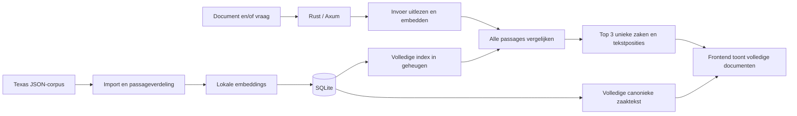

# Architectuurgids

## Huidige stand

Deze bootstrap bevat uitsluitend documentatie, het [API-contract](openapi.yaml) en synthetische [fixtures](examples/search-response.json). Er zijn nog geen Rust-bronbestanden, SQLite-database, frontend, CI of werkende endpoints. Alle uitvoeringsstappen hieronder zijn **voorgenomen ontwerp**. Voeg bij implementatie echte codeverwijzingen en gecontroleerde commando's toe; presenteer dit ontwerp niet als werkende code.

De [README](../README.md) is het startpunt; [AGENTS.md](../AGENTS.md) bepaalt hoe agents samenwerken. Het contract is een productafspraak. Deze gids legt de samenhang, afwegingen en grenzen uit.

## Gebruik en geplande hoofdroute

Een gebruiker geeft een document en/of vraag. De app toont drie verschillende uitspraken, met per zaak de volledige tekst van het meerderheidsoordeel (majority opinion) en de best scorende passage gemarkeerd.

De voorlopige mapverdeling is `backend/` voor de Rust-service en `frontend/` voor de aparte frontend-agent. Die mappen bestaan nog niet. Gedeeld werk zit nu in `docs/`; contractwijzigingen worden afgestemd voordat een agent erop gaat bouwen.

## Corpus, opslag en index

Het lokale corpus staat in `/Users/R0GUE/Downloads/texas-criminal-reports`. De eerdere data-inspectie vond 135 historische uitspraken van het Texas Court of Criminal Appeals uit 1892–1893, volledige JSON-teksten en bijbehorende HTML. De volumemetadata vermeldt foutief 1992–1993; import gebruikt `decision_date` per zaak.

De import moet zaak-ID, metadata, bronidentificatie en oorspronkelijke opinion-typen bewaren. De eerste zoekindex gebruikt de majority opinion, het oordeel van de meerderheid. Concurrence en dissent blijven herkenbaar en worden niet ongemerkt met het meerderheidsoordeel vermengd.

SQLite zal zaken, canonieke tekst, passages en embeddings bewaren. Per zaak bepaalt `text_version` de versie van de canonieke tekst; `corpus_version` identificeert de complete geïmporteerde dataset en verwerking. Model, modelversie en passageverdeling worden bij de index vastgelegd. Herimport is herhaalbaar en mag geen dubbele zaken maken. Uploads worden alleen voor de zoekopdracht verwerkt en hoeven niet duurzaam te worden opgeslagen.

De hele index wordt bij serverstart in geheugen geladen. Readiness volgt pas nadat alle 135 afgesproken zaken en hun geldige passages aanwezig zijn. Een partiële of kapotte index geeft een fout; die mag niet als volledige top-driezoekfunctie worden gepresenteerd.

## Embeddings en zoekmethode

Corpus en invoer gebruiken hetzelfde lokale embeddingmodel via fastembed. De COA-kern is technisch herbruikbaar; de precieze modelkeuze en geschiktheid voor juridisch Engels moeten bij implementatie en kwaliteitsevaluatie worden vastgelegd. Een modeldownload en compilatie kunnen nodig zijn; er zijn nog geen doorlooptijden gemeten.

Uitspraken en uploads worden in korte, deels overlappende passages verdeeld, binnen de invoerlimiet van het gekozen model. Tekstposities moeten naar de opgeslagen canonieke tekst blijven verwijzen. Niet stilzwijgend lange teksten afkappen.

De eerste rankingmethode, `cosine-max-v1`, werkt als volgt:

1. **Vraag:** cosinusovereenkomst tussen vraagvector en iedere corpuspassage.
2. **Document:** normaliseer het gemiddelde van de documentpassagevectoren opnieuw en vergelijk dat met iedere corpuspassage.
3. **Beide:** `0.7 * query_score + 0.3 * document_score`, met bovenstaande cosinusovereenkomsten.
4. Vergelijk alle passages. De score van een zaak is de hoogste passagescore binnen die zaak. Kies bij gelijke passagescores de laagste `passage_id` (lexicografisch).
5. Sorteer alle zaken op score aflopend; bij gelijke scores op `case_id` lexicografisch oplopend. Geef precies de eerste drie terug.

De gewichten zijn een voorlopige ontwerpkeuze, geen gevalideerd optimum. Nulvectoren en onbruikbare invoer mogen geen NaN-scores opleveren; geef dan een duidelijke fout.

Er is geen benaderende vectorindex of voorafgaande kandidaatselectie nodig bij deze corpusomvang. De harde garantie is **de drie hoogst scorende unieke zaken binnen de volledige afgesproken index, volgens deze methode**. Deze garantie zegt niet dat de drie zaken voor iedere juridische vraag inhoudelijk de meest relevante zijn. Er is nog geen gevalideerde ondergrens voor relevantie; een succesvolle zoekopdracht kan lage scores bevatten.

## Documenten en markeerbare passages

Het zoekresultaat geeft per zaak één originele passage, een stabiele passage-ID en `start_utf16`/`end_utf16` terug. Het detailendpoint geeft de volledige canonieke tekst van het meerderheidsoordeel; afwijkende of aanvullende opinions horen niet bij deze tekst. Tekstposities gelden voor die exacte tekst en `text_version`; het einde is exclusief. UTF-16-eenheden sluiten aan bij JavaScript `slice`, ook bij tekens buiten de BMP. Rust moet de eenheden expliciet bepalen; UTF-8-byteposities zijn niet uitwisselbaar met deze posities.

De backend normaliseert tekst één keer bij import, bewaart die tekst en berekent alle passagegrenzen daarop. De frontend normaliseert deze tekst niet opnieuw en controleert versies vóór het markeren. Dit levert leesbare volledige documenten met markeringen op; een originele PDF-layout of PDF-coördinaten zijn niet onderdeel van dit corpuscontract.

## Gericht hergebruik uit COA

De code-inspectie in `../coa` wees deze bestaande bouwstenen aan:

| Onderdeel | Gecontroleerd bestaand codepad | Betekenis voor deze app |
|---|---|---|
| Embeddings en zoeken | `../coa/src/lib.rs`, `Index::load`, `Index::search_with_top_k` | Zoekkern als vertrekpunt; ingebouwde datasetloader vervangen. |
| Cosinus en sortering | `../coa/src/ranking.rs` | Domeinonafhankelijke berekening gericht overnemen. |
| Eerst zoeken, dan modelcontext | `../coa/src/experiment/runner.rs`, `dense_once` | Alleen patroon; de experimentrunner niet meenemen. |
| Bron/citaatcontrole | `../coa/src/experiment/arms.rs`, `validate_answer` | Pas relevant bij een latere uitbreiding met antwoordgeneratie. |

Deze paden liggen buiten deze repo en zijn daarom oriëntatiepunten, geen beschikbare projectmodules. Verifieer de actuele COA-code opnieuw voordat je iets overneemt. De COA-parser verwerkt maximaal vijf ingebouwde Markdown-documenten en biedt geen algemene PDF-upload of SQLite-opslag. Codex-processen, MCP, activiteitprompts en experimentinfrastructuur worden niet overgenomen.

## Scope en beperkingen

- Alleen UTF-8-TXT en PDF met uitleesbare tekst. OCR voor scans is niet onderdeel van de eerste versie.
- Lokale embeddings en ophalen van zaken; geen gegenereerd juridisch advies en geen Orq- of Codex-aanroep nodig.
- Het corpus is klein en historisch; resultaten zijn geen volledig of actueel overzicht van Texas-rechtspraak.
- Een gemiddelde documentvector kan deelonderwerpen vervagen. De beste passage per zaak kan lange uitspraken bevoordelen. Beoordeel beide met inhoudelijke voorbeelden.
- Overeenkomende scores en tekstmarkeringen bewijzen geen juridische juistheid, volledigheid of toepasselijkheid.

## Verificatie bij implementatie

Er is nog geen projecttestcommando. De implementatie moet aantoonbaar maken:

- alle drie invoermodi, PDF/TXT en duidelijke fouten bij onbruikbare invoer;
- precies drie unieke zaken, volledige scoring en deterministische gelijke scores;
- dezelfde corpus- en tekstversies, met UTF-16-posities die exact de aangeboden passage selecteren;
- herhaalbare import en dezelfde beschikbare index na herstart;
- onafhankelijke controle van ranking met bekende vectoren én aparte inhoudelijke beoordeling;
- een echte HTTP-upload, zoeken en ophalen van volledige documenten.

Contract- en fixturechecks moeten later in de echte CI aansluiten op de gekozen projecttools. De bootstrap is handmatig gecontroleerd en onafhankelijk gereviewd; de canonieke documenten zijn nog geen mechanisch afgedwongen mergegate.

## Recente architectuurwijzigingen

- 2026-11-11: repo-overdracht en API-ontwerp toegevoegd. Scope vastgelegd als document en/of vraag, exact drie unieke zaken en volledige majority-opinionteksten met UTF-16-markeerposities. Nog geen runtime-implementatie.
